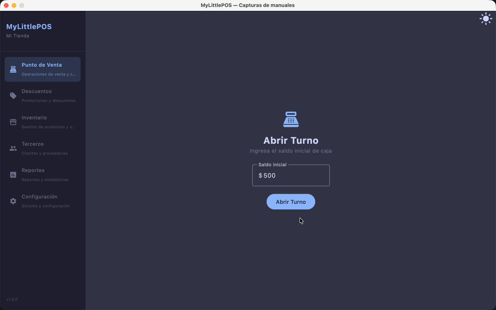
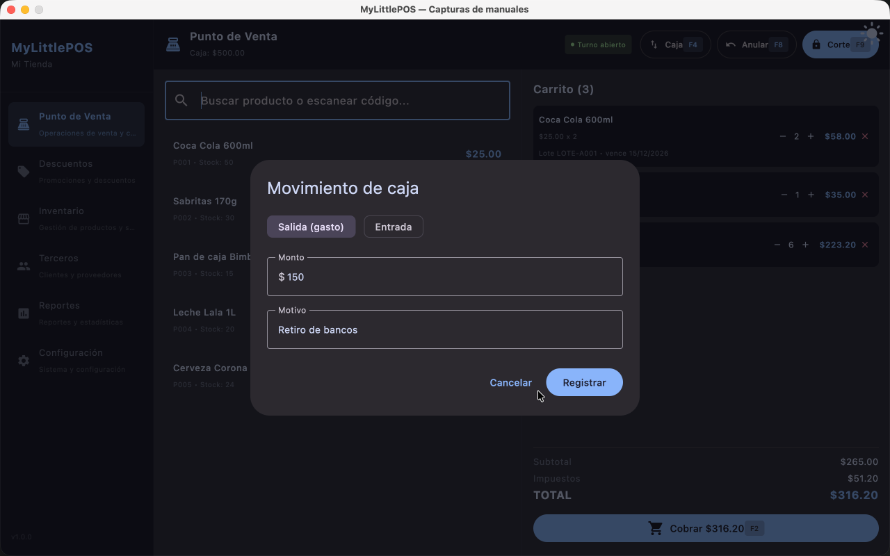
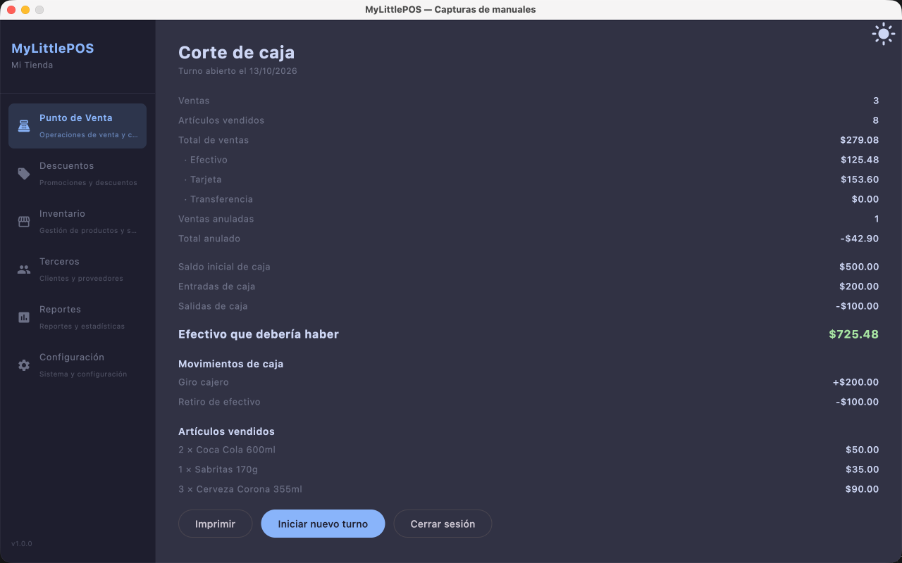

# Manual — Caja

> Corresponde a la versión 1.0.0. La caja no es una pantalla propia: se maneja desde el
> **Punto de Venta** (menú lateral → **Punto de Venta**).

La caja es el **turno**: el periodo entre el momento en que abres la caja con una plata
inicial y el corte final del día. Todo lo que mueve efectivo —ventas en efectivo,
entradas y salidas manuales, compras que afectan caja— se acumula sobre ese turno.

## Abrir la caja

1. Ve al **Punto de Venta**. Si no hay turno abierto, se muestra la pantalla de apertura.
2. Carga el **saldo inicial**: la plata que dejas en el cajón al empezar (no puede ser negativo).
3. Toca **Abrir turno**.

Con el turno abierto, la cabecera del PV muestra **Caja: $…** con ese saldo inicial, y
aparecen los botones de **Movimiento** y **Corte**.

> Solo puede haber **un turno abierto a la vez**.

## Movimientos de caja

Los movimientos registran plata que entra o sale del cajón **sin ser una venta**:
un pago a un proveedor suelto, un retiro, un depósito, un ajuste.

1. Toca **Movimiento** en el PV (con turno abierto).
2. Elige el tipo: **Salida (gasto)** o **Entrada**.
3. Carga el **monto** y el **motivo** (ambos obligatorios).
4. Toca **Registrar**.

El movimiento queda pegado al turno actual y aparece en el corte.

> Los gastos grandes del negocio (alquiler, sueldos, luz) **no** van aquí: se cargan en
> **Gastos** y no entran en el corte de caja.

## Qué más mueve la caja

- **Ventas en efectivo**: entran por el total de cada venta.
- **Ventas con tarjeta o transferencia**: NO tocan el efectivo del cajón; solo se
  informan en el corte.
- **Compras marcadas "Afecta el movimiento de caja"**: salen como egreso al finalizar
  la compra (ver [Manual de Compras](manual-compras.md)).
- **Devoluciones de esas compras**: vuelven como entrada.
- **Anulación de una venta**: la venta sale del corte y el stock vuelve.

## El corte

El corte cierra el turno y muestra el resumen del día.

1. Toca **Corte** en el PV y confirma (así no se cierra por un clic accidental).
2. Se muestra el informe:
   - **Ventas**: cantidad, artículos vendidos y total, desglosado en efectivo, tarjeta
     y transferencia.
   - **Saldo inicial**, **entradas** y **salidas** de caja.
   - **Efectivo que debería haber** (destacado): saldo inicial + ventas en efectivo +
     entradas − salidas. Cuenta el cajón y compara con ese número.
   - El detalle de **movimientos** y de **artículos vendidos** del turno.
3. Al terminar de revisar, elige **Iniciar nuevo turno** (sigue cobrando) o
   **Cerrar sesión**.

---

**Ver también**: [Manual del Punto de Venta](manual-punto-de-venta.md) ·
[Manual de Compras](manual-compras.md)
