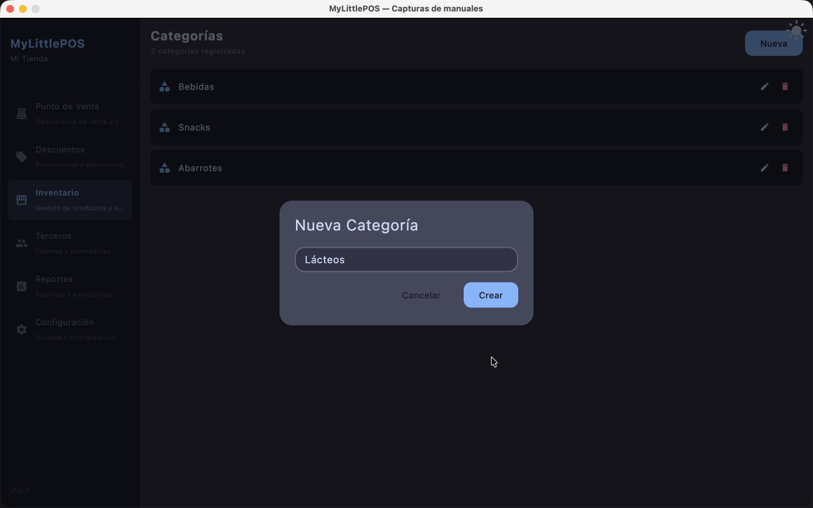
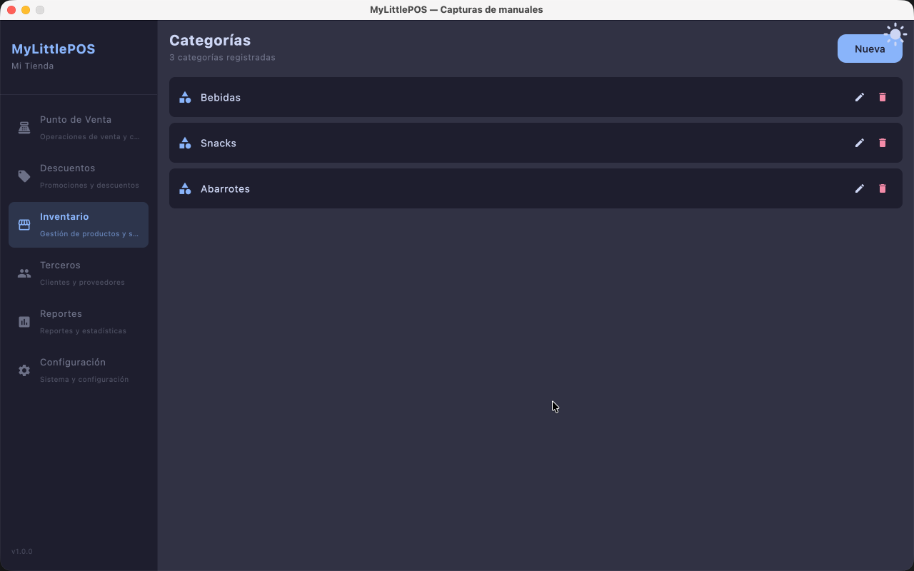

# Manual — Categorías

> Corresponde a la versión 1.0.0. Desde el menú lateral: **Inventario → tab Categorías**.

Las categorías agrupan productos (bebidas, abarrotes, limpieza, etc.) y sirven para
filtrar el catálogo y organizar los reportes.

---

## 1. Crear una categoría

1. Ve a **Inventario → tab Categorías**.
2. Haz clic en **Nueva** (arriba a la derecha).
3. Carga el **nombre** (obligatorio) y haz clic en **Crear**.

El nombre no se puede repetir: se comparan ignorando mayúsculas, espacios y acentos, así
que "Bebidas" y "bebidas" son la misma. Si ya existe, el campo te avisa y no se guarda nada.

## 2. Editar una categoría

Haz clic en el icono ✏️ de la categoría, cambia el nombre y haz clic en **Guardar**.

## 3. Eliminar una categoría

Haz clic en el icono 🗑 de la categoría y confirma en el diálogo. El aviso te advierte que **los productos asignados quedarán
sin categoría**: no se borra ningún producto, solo pierden esa etiqueta y hay que
reasignarlos desde Inventario → Productos.

## 4. Usar las categorías

- **En Productos**: elige la categoría de cada producto al crearlo o editarlo.
- **En el catálogo de productos**: el panel lateral "Todas" filtra el catálogo por la
  categoría elegida.

---

**Ver también**: [Manual de Productos](manual-productos.md) ·
[Manual de Inventario](manual-inventario.md)
