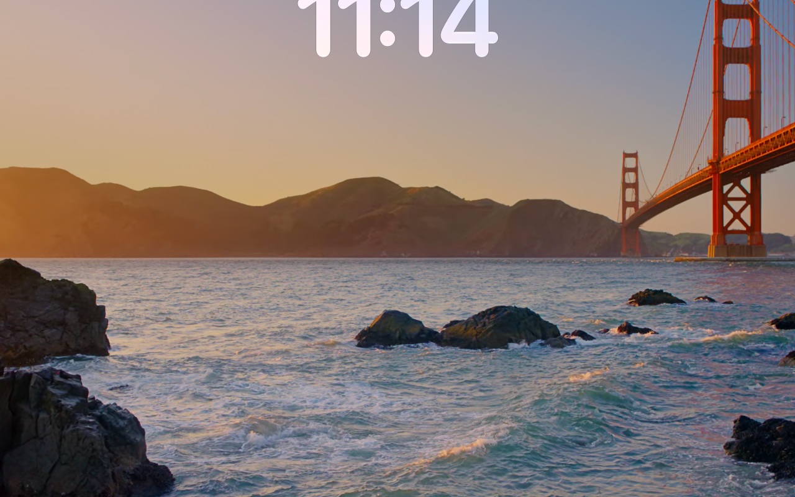

# Manual — Clientes y Proveedores

> Corresponde a la versión 1.0.0. Desde el menú lateral: **Terceros**, con dos tabs:
> **Clientes** y **Proveedores**.

Los terceros son las personas y empresas con las que el negocio trata: los **clientes**
(compran en el PV) y los **proveedores** (venden mercadería que entra por Compras).
Cada catálogo es un tab con su propia lista y su propio formulario.

---

## Tab Clientes

### Crear un cliente

1. Andá a **Terceros → tab Clientes** y tocá **Nuevo**.
2. Cargá el **nombre** (es lo único obligatorio) y, si querés, **teléfono**, **correo**,
   **RFC** y **dirección** (son todos opcionales; si los cargás, se comprueban los
   formatos: teléfono solo dígitos, correo con @, RFC con su formato).
3. Tocá **Crear**. El sistema le asigna un código único tipo `CLI-0001`.

No se puede crear dos clientes con el mismo nombre (se comparan ignorando mayúsculas,
espacios y acentos).

### Editar o dar de baja

- Tocá el ícono de **lápiz** de una fila para editarla.
- Tocá el ícono de **papelera** para dar de baja. La baja es **lógica**: el cliente no
  se borra, queda marcado **Inactivo** — las ventas pasadas lo siguen citando.

### El cliente Mostrador

La lista incluye siempre **Mostrador (sin cliente)**: es el cliente del sistema para
las ventas sin cliente identificado. **No se edita ni se da de baja.**

> En el cobro del PV se puede elegir a qué cliente le vendés; si no se elige nadie,
> la venta queda para Mostrador.

---

## Tab Proveedores

Funciona igual que Clientes, con su propio catálogo:

1. **Terceros → tab Proveedores → Nuevo**.
2. Cargá el **nombre** (obligatorio); teléfono, correo, RFC y dirección son opcionales.
3. **Crear**: cada proveedor recibe un código tipo `PRV-0001`.

Las compras se cargan eligiendo proveedor (ver [Manual de Compras](manual-compras.md));
si el proveedor de la factura todavía no existe, también se puede crear **desde la
misma compra**, con el ícono **+** de al lado del desplegable.

### El proveedor general

**Proveedor general (del sistema)** es el de las compras sin proveedor identificado.
Tampoco se edita ni se da de baja.

> Si un proveedor se da de baja, las compras viejas que lo citan siguen mostrando su
> nombre.

---

**Ver también**: [Manual de Compras](manual-compras.md) ·
[Manual del Punto de Venta](manual-punto-de-venta.md)
