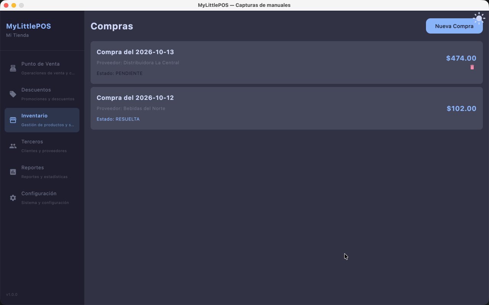
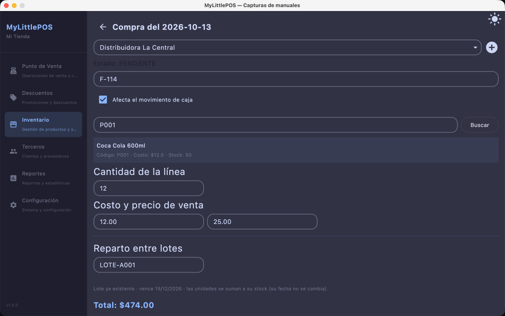
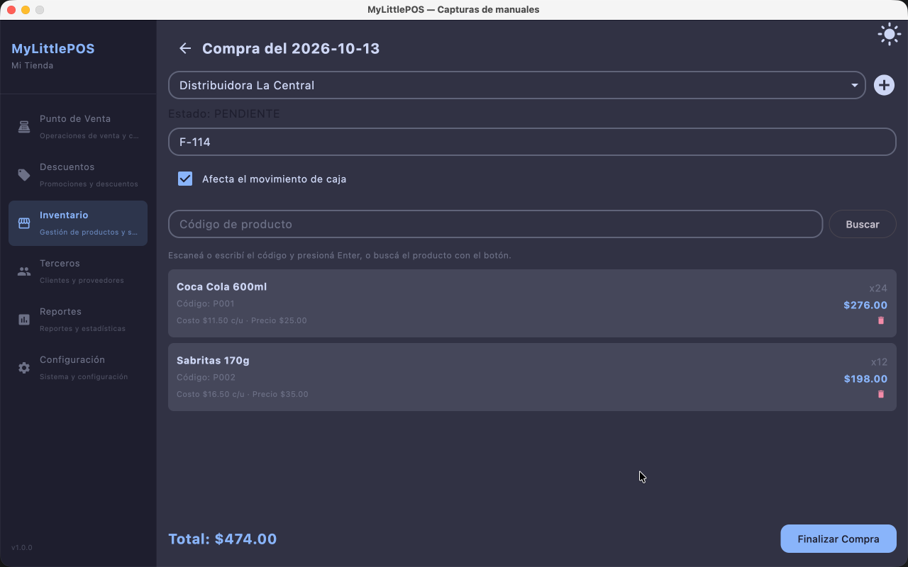

# Manual — Compras

> Corresponde a la versión 1.0.0. Desde el menú lateral: **Inventario → tab Compras**.

Las compras registran la mercadería que entra al negocio. Una compra aplicada
**suma stock**, **actualiza el costo** de los productos comprados y, si marcas que
afecta la caja, registra la **salida de plata del turno abierto**.

Si algo salió mal con una compra del día (costo cargado de más, mercadería dañada),
la misma pantalla permite **corregirla**: devuelve lo que corresponda al inventario
y, si hiciste la compra sobre caja, a la caja.

---

## El listado

La tab Compras muestra una tarjeta por compra: fecha, proveedor, estado y total.

- **Estado RESUELTA**: la compra ya se aplicó (stock y costos actualizados).
- **Estado PENDIENTE**: es un borrador que todavía no se aplicó; se puede seguir
  editando o descartar con el ícono de papelera.
- Una compra ya aplicada **no se borra**: se corrige (ver más abajo).

El botón **Nueva Compra** abre una compra en blanco en estado PENDIENTE.

## Cargar una compra

1. Ve a **Inventario → Compras** y toca **Nueva Compra**.
2. Elige el **Proveedor** en el desplegable. Si el que necesitas no existe, toca el
   ícono **+** de al lado para crearlo ahí mismo (queda seleccionado al instante).
   El **Proveedor general** es el de siempre para compras sin proveedor identificado.
3. Si quieres, carga el **Folio** del comprobante (es opcional).
4. Marca **Afecta el movimiento de caja** solo si quieres que el pago salga del turno
   abierto. Sin turno abierto el casillero aparece apagado, con el aviso
   *"Para registrar el egreso necesitas un turno de caja abierto."*

### El mostrador de ingreso

Para agregar productos usa el **mostrador de ingreso**, pensado como cargar una
factura en el mostrador:

1. **Escanea o escribe el código** del producto y presiona **Enter**: el sistema lo
   busca en el catálogo y muestra una ficha con nombre, código, costo y stock actual
   (conoce de un vistazo que el código cayó en el producto correcto).
   - Si no tienes el código a mano, toca **Buscar** y elige el producto de una lista.
2. Carga la **cantidad** total de la línea.
3. Revisa el **costo unitario** y el **precio de venta**: arrancan con los valores
   vigentes del producto y siempre se pueden editar. Si al cambiar el costo el precio
   de venta se queda con un margen raro, aparece un aviso con la sugerencia —
   tú decides si la aceptas.
4. Si el producto maneja **lotes**, decide si asignas las unidades a un lote existente
   o repartes la cantidad entre varios lotes. Al asignar un lote que ya existe, las
   unidades se suman a su stock y **su fecha de vencimiento no se cambia**:

   
5. Toca **Agregar a la compra**: la línea pasa al listado y el mostrador queda limpio
   y con el cursor listo para el siguiente código.
6. **Soltar la línea** descarta lo escaneado por error sin agregarlo.

Repite por cada producto de la factura.

### Finalizar la compra

Cuando el listado tiene todas las líneas, toca **Finalizar Compra**:

- la compra pasa a **RESUELTA**;
- el **stock** de cada producto sube (y de sus lotes, si se repartieron);
- el **costo** y el **precio de venta** de los productos quedan actualizados con los
  valores que cargaste en cada línea;
- si la compra estaba marcada como **Afecta el movimiento de caja**, se registra un
  **egreso** por el total en el turno de caja abierto.

## Corregir una compra del día

¿Recién saliste de la compra y ves un error? La compra se corrige **solo si es del
día de hoy y ya está RESUELTA** (nunca se corrige dos veces lo mismo).

1. Ve al listado, abre la compra y toca **Corregir**.
2. Cada línea muestra lo que puedes corregir:
   - **Devolución de mercadería**: indicas cuántas unidades vuelven y **de qué lote**
     salen; esas unidades se descuentan del stock.
   - **Corrección de costo/precio**: arreglas el par costo y precio de una línea; los
     precios del catálogo se ajustan según corresponda.
3. Toca **Aplicar corrección**. Si hay productos cuyo precio hoy difiere del que
   tenía la compra, te pregunta **¿Con qué precio quedan?**: marca los que deban
   volver a como estaban **antes** de la compra, o dejalos como están.
4. Si la compra se hizo saliendo de plata de caja, la devolución registra la
   **entrada** correspondiente en el turno abierto.

La corrección queda asentada como documento nuevo junto a la compra, así siempre
puedes ver qué se devolvió y por qué.

---

**Ver también**: [Manual de Inventario](manual-inventario.md) ·
[Manual de Productos](manual-productos.md) ·
[Manual de Caja](manual-caja.md) · [Manual de Clientes y Proveedores](manual-clientes-proveedores.md)
