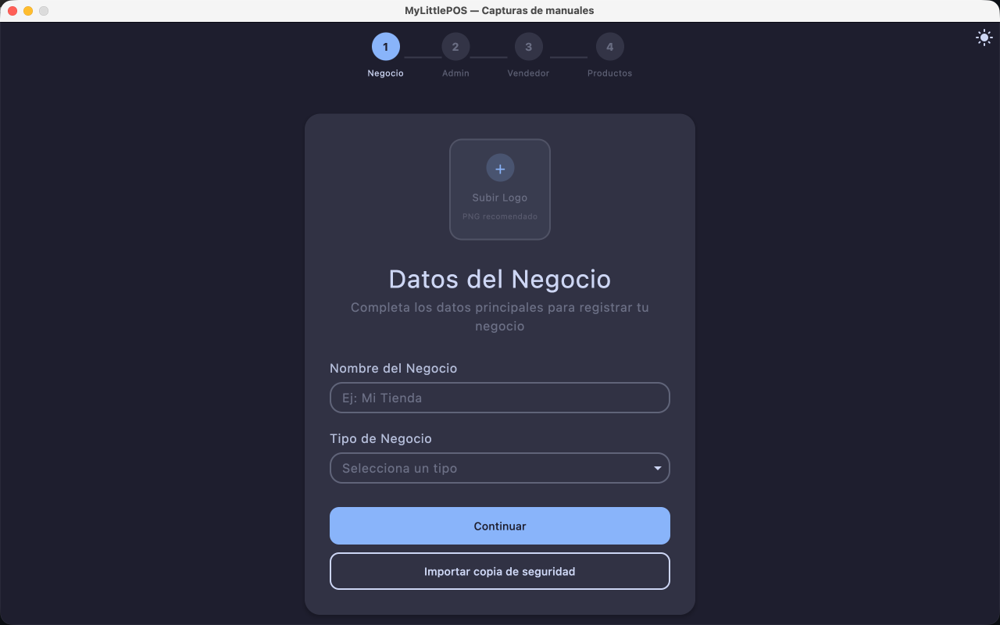
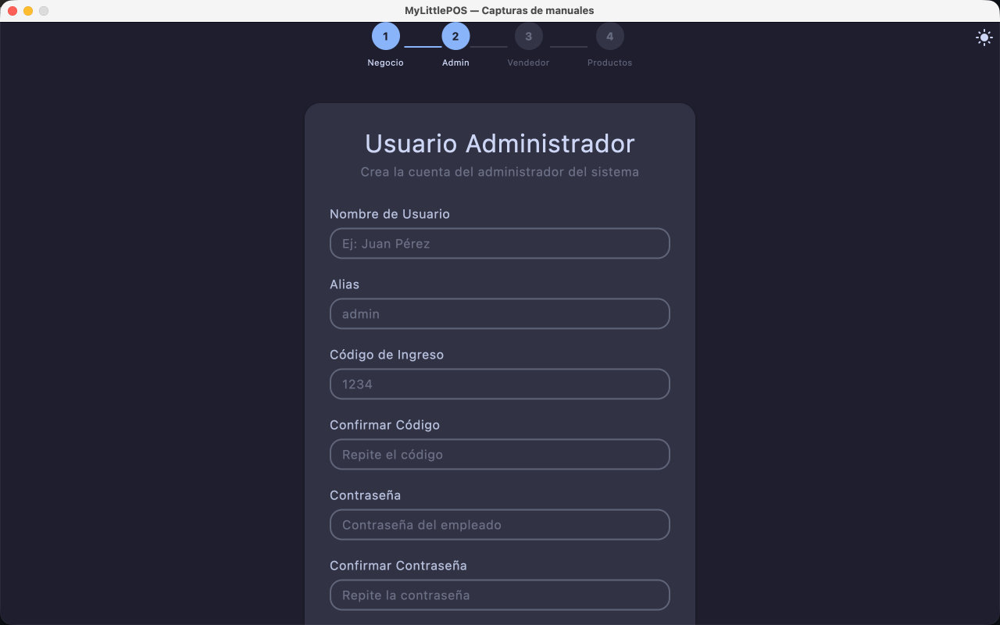
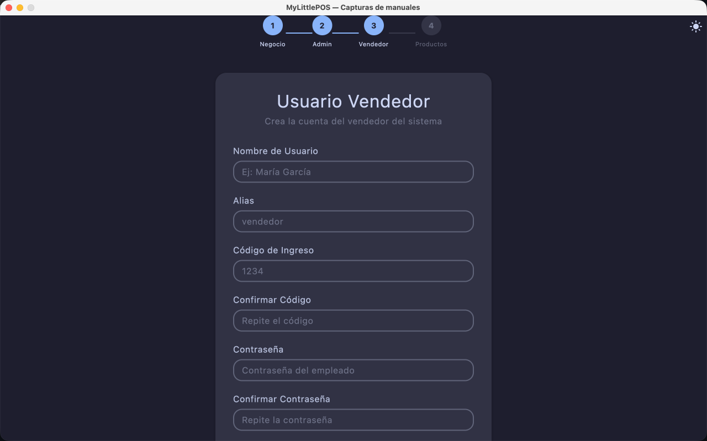
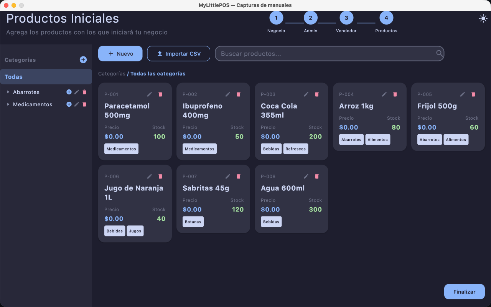

# Manual — Configuración inicial

> Corresponde a la versión 1.0.0. El asistente aparece **solo dos veces**: en la primera
> instalación y después de un **Eliminar datos del negocio** (reset de fábrica).

Son cuatro pasos, indicados en la parte superior: **Negocio → Admin → Vendedor → Productos**.
Cada paso guarda lo suyo al pulsar **Continuar** y la configuración queda completa recién con
**Finalizar**, que abre el [inicio de sesión](manual-login.md).

## Paso 1 — Negocio

1. (Opcional) Haz clic en el cuadro **Subir Logo** para elegir la imagen de tu negocio
   (**PNG recomendado**). Sin logo el asistente igual continúa.
2. Carga el **Nombre del Negocio** (obligatorio).
3. Elige el **Tipo de Negocio** (obligatorio): **Abarrotes**, **Farmacias** o **Veterinarias**.
4. Haz clic en **Continuar**.

### Importar una copia de seguridad

Debajo de **Continuar** está **Importar copia de seguridad**: elige un archivo `.realm`
(generado desde Configuración → Sistema → Copia de seguridad) y ocurre una de tres:

- La copia trae la **configuración completa**: se importa y pasas directo al inicio de
  sesión, sin completar el asistente.
- La copia está **a medias**: el formulario del paso 1 se rellena con sus datos y sigues
  desde ahí.
- El archivo **no sirve**: aparece el aviso abajo y continúas en el paso 1.

> Importar **reemplaza** lo que había en la aplicación.

## Paso 2 — Usuario administrador

1. **Nombre de Usuario**: nombre completo (mínimo 2 caracteres).
2. **Alias**: el que usarás para entrar al sistema.
3. **Código de Ingreso**: solo números, mínimo 4; **Confirmar Código** debe repetirlo
   exactamente.
4. **Contraseña**: mínimo 4 caracteres; admite letras y símbolos. **Confirmar Contraseña**
   debe repetirla.
5. Haz clic en **Continuar**.

> El texto gris de los campos es una **sugerencia**, no un dato cargado. Si dejas **Alias**,
> **Código de Ingreso** o **Contraseña** vacíos, la aplicación guarda el valor de ejemplo
> (`admin`, `1234`, `1234`). En un equipo de producción rellénalos antes de continuar.
>
> **Código de Ingreso** y **Contraseña** son datos distintos: para entrar se usa la
> **contraseña**; el código identifica al empleado dentro del sistema.

## Paso 3 — Usuario vendedor

Los mismos campos del paso anterior, con el **Alias** sugerido `vendedor`: nombre, alias,
código de ingreso con su confirmación y contraseña con su confirmación. Igual que antes, lo
que dejes vacío se guarda con el valor de ejemplo (`vendedor`, `1234`, `1234`). **Continuar**
avanza a los productos.

> Este es el **único paso con la flecha Atrás** (arriba a la izquierda), que regresa al paso
> del administrador. En los demás pasos no hay vuelta atrás (ver
> [Si te equivocaste](#si-te-equivocaste-en-un-paso)).

## Paso 4 — Productos iniciales

**Productos Iniciales** — *Agrega los productos con los que iniciará tu negocio*. El paso
maximiza la ventana y bloquea su tamaño mientras dure.

- **Categorías**: panel izquierdo con el árbol de categorías (en ventana angosta se ve como
  una fila de chips arriba).
  - **+** crea una categoría o una subcategoría dentro de la seleccionada.
  - El **lápiz** renombra en el lugar y el **papelera** pide confirmación.
  - Si la categoría tiene productos o subcategorías, el diálogo **Eliminar categoría** ofrece
    **Mover productos y subcategorías a otra categoría** (**Mover y eliminar**) o eliminar
    igual (**Eliminar de todos modos**); los productos que queden sin categoría deberán
    recategorizarse después.
- **Buscar productos...** filtra por código o descripción; el chip **Todas** (o una categoría
  concreta) acota la lista a esa rama.
- **Nuevo** abre el formulario **Nuevo Producto**: el mismo del
  [Manual de Productos](manual-productos.md) (código, descripción, precios, stock, lotes,
  impuestos y campos de caducidad).
- **Importar CSV** abre **Importar productos (CSV)**:
  1. **Descargar plantilla** genera el archivo con la estructura y ejemplos
     (columnas: `codigo`, `descripcion`, `categoria`, `costo`, `precio`, `existencias`,
     `stockMinimo`, `tipoUnidad`, `esMedicamento`, `compuestos`, `impuestos`).
  2. **Seleccionar archivo** importa tu planilla. Los problemas se listan **fila por fila**
     con su motivo.
  3. Si un impuesto viene **sin porcentaje**, el diálogo lo pide y se aplica con
     **Aplicar tasas**.
- En la grilla, cada producto ofrece **Editar**, **Eliminar** y **Ver más**.

Cuando tengas lo mínimo para vender, haz clic en **Finalizar** (abajo a la derecha): se
guardan categorías y productos y la aplicación abre el inicio de sesión.

## Si te equivocaste en un paso

Fuera del paso Vendedor no hay botón **Atrás**, pero nada queda atrapado: se corrige desde la
aplicación cuando termines.

| Dónde quedó | Cómo se corrige después |
|-------------|-------------------------|
| Nombre o tipo de negocio | **Configuración → Negocio** |
| Datos de los empleados | **Configuración → Empleados** |
| Productos o categorías | **Inventario** |

Y si prefieres arrancar de cero: **Configuración → Sistema → Eliminar datos del negocio**
borra todo, cierra la sesión y **vuelve a abrir este asistente**.

> Si cierras la aplicación a mitad del asistente, al abrirla de nuevo **empieza por el paso 1**:
> la configuración solo queda marcada como completa con **Finalizar**.

---

**Ver también**: [Manual de inicio de sesión](manual-login.md) ·
[Manual de Productos](manual-productos.md) · [Manual de Configuración](manual-configuracion.md)
