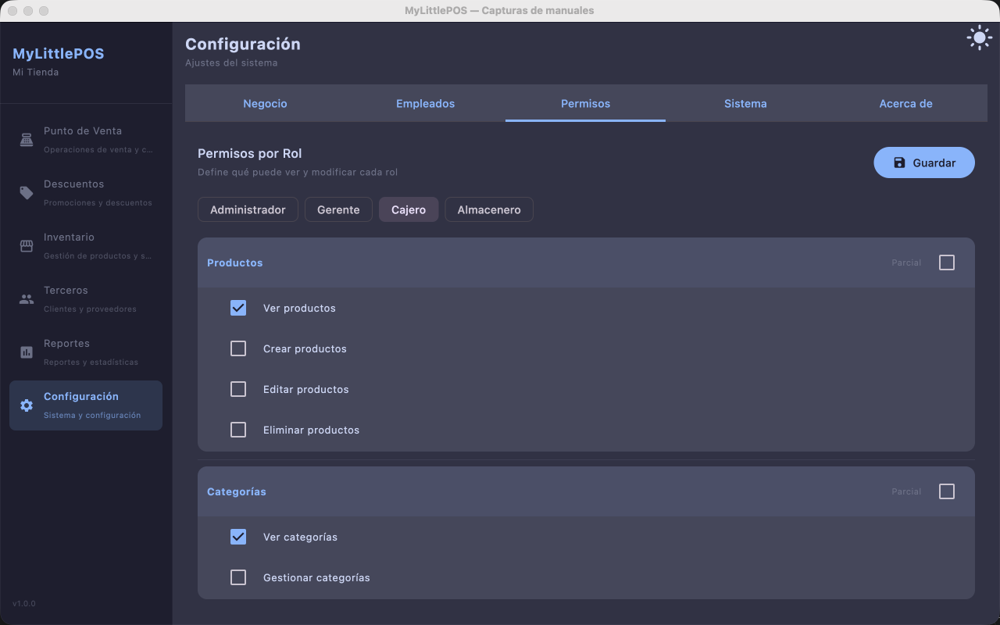
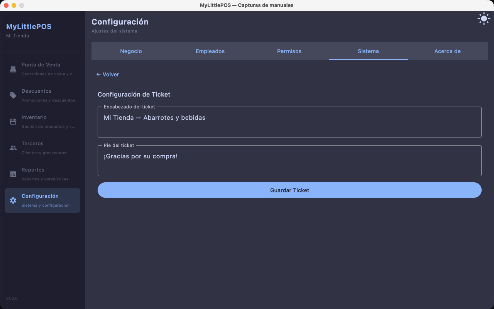
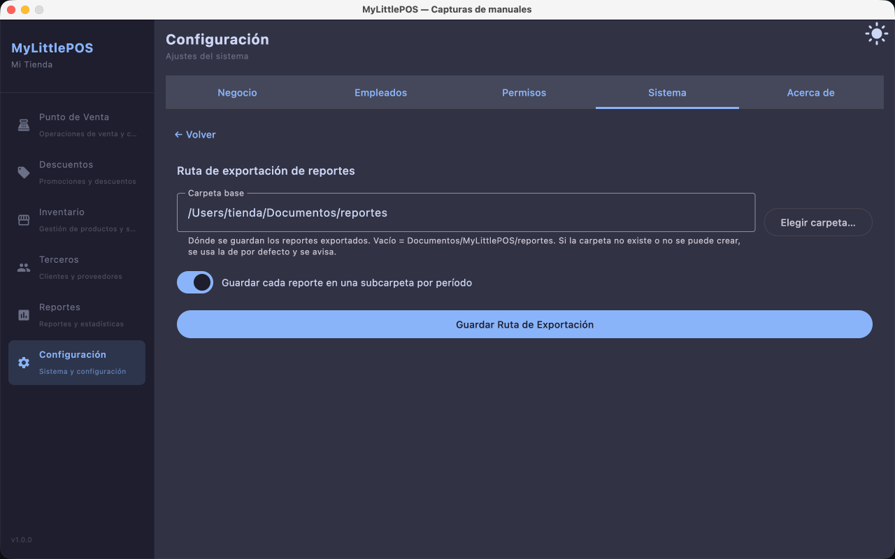
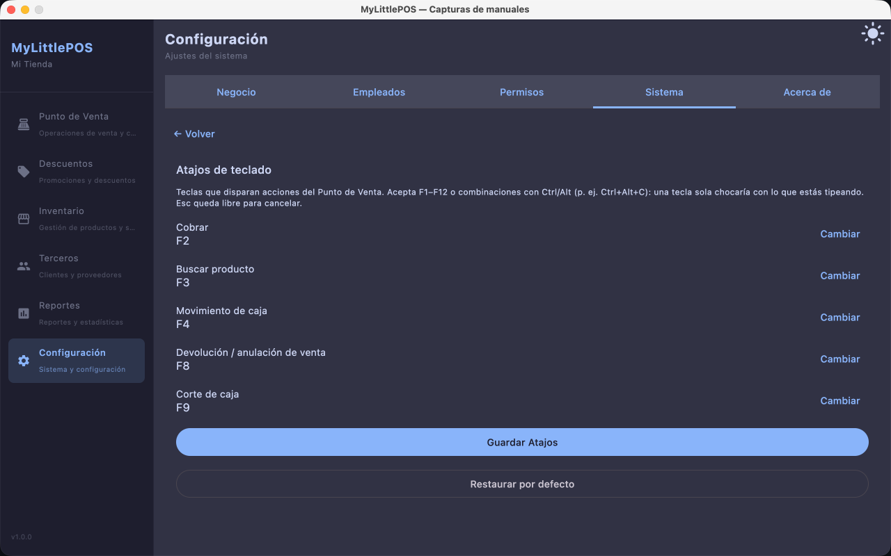
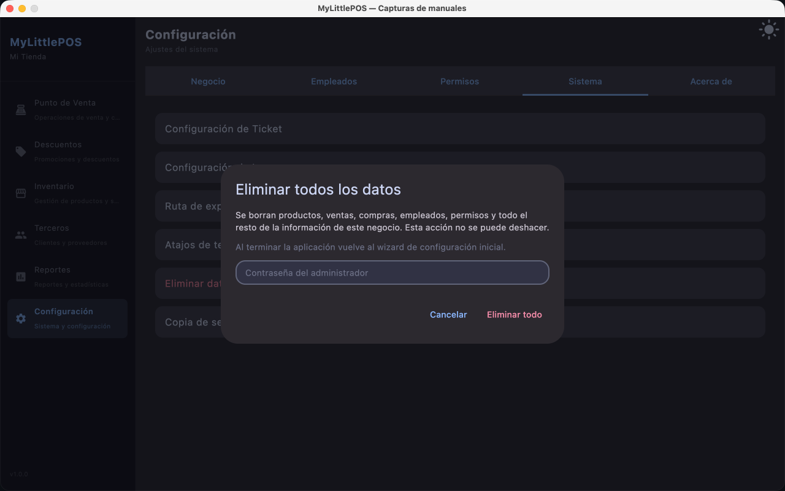
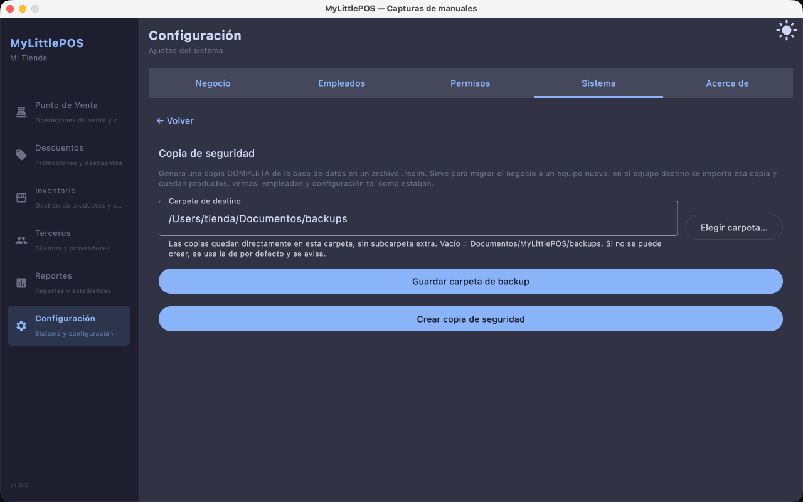

# Manual — Configuración

> Corresponde a la versión 1.1.0. Desde el menú lateral: **Configuración**.

Configuración administra el negocio: sus datos, los empleados y sus permisos, y las
opciones del sistema (ticket, impresora, exportaciones, atajos, copias de seguridad).
Tiene cinco tabs: **Negocio**, **Empleados**, **Permisos**, **Sistema** y **Acerca de**.

> Cada tab y cada sección se muestran **según los permisos del usuario**: un empleado
> sin permisos de configuración ve menos (o no ve) estas pantallas.

## Tab Negocio

Los datos que identifican al negocio (aparecen, por ejemplo, en los tickets):

1. Carga **Nombre *** (obligatorio) y elige **Giro *** en el desplegable (obligatorio):
   **Tienda General**, **Tienda de Abarrotes**, **Tienda Departamental**, **Farmacia**,
   **Ferretería**, **Tlapalería** o **Recaudería**. Si el giro guardado es de una versión
   anterior y no está en la lista, se muestra tal cual: puedes elegir otra opción para
   cambiarlo. Si quieres, completa **Dirección**, **Teléfono**, **RFC** y **Correo**.
2. Haz clic en **Guardar**.

## Tab Empleados

Quienes pueden usar el sistema, cada uno con su alias, código y rol.

- **Nuevo**: carga **Alias *** y **Contraseña *** (lo que se teclea en el
  [inicio de sesión](manual-login.md)), nombre completo y **rol**, y guarda. El
  **código** (`EMP-0001`, `EMP-0002`, ...) **no se carga**: lo genera la aplicación
  en orden al guardar.
- El ícono de **llave** de cada fila abre los **permisos** de ese empleado.
- **Lápiz** para editar (el código aparece **de solo lectura**; la contraseña vacía
  no se cambia) y **papelera** para eliminar, con confirmación.

## Tab Permisos

**Permisos por rol**: qué puede ver y modificar cada rol. Marca los permisos de cada
rol y haz clic en **Guardar**. Las demás pantallas (y las secciones de Sistema) se muestran
o esconden según estos permisos.

## Tab Sistema

Un listado de secciones; al hacer clic en una, su formulario ocupa la pantalla y
**← Volver** regresa al listado.

### Configuración de Ticket

**Encabezado** y **pie** del ticket. Haz clic en **Guardar Ticket**.

### Configuración de Impresora

Para la impresora térmica ESC/POS:

1. Haz clic en **Detectar puertos** y elige el **Puerto** detectado (o escríbelo a mano).
2. Carga **ID Dispositivo** y elige el **Tamaño de Papel** en el desplegable: **58 mm** u
   **80 mm** (por defecto **80 mm**).
3. **Imprimir ticket por defecto al confirmar la venta** define el valor inicial del check
   **Imprimir ticket** que aparece en cada cobro del PV: con el switch activado, el check
   viene marcado y solo hay que desmarcarlo cuando no quieras el ticket de esa venta. Si
   nunca tocas el check en el cobro, manda este switch.
4. Haz clic en **Imprimir prueba** para comprobar la conexión, y en **Guardar Impresora**.

### Ruta de exportación de reportes

**Carpeta base** donde quedan los reportes exportados desde Reportes. Si la dejas vacía,
la ruta por defecto es **Documentos/MyLittlePOS/reportes** (si esa carpeta no existe o no
se puede crear, la aplicación avisa). Con **Elegir carpeta…** se elige con el explorador,
y la opción de subcarpeta por período agrupa los archivos por rango de fechas.
Haz clic en **Guardar Ruta de Exportación**.

### Atajos de teclado

Teclas que disparan acciones del PV. Haz clic en **Cambiar** en una fila y presiona la tecla
nueva: acepta **F1–F12** o combinaciones con **Ctrl/Alt** (una tecla sola chocaría con
lo que se está escribiendo). **Esc** queda libre para cancelar. Si la tecla ya está
usada por otra acción, se avisa. Al terminar, haz clic en **Guardar Atajos**;
**Restaurar por defecto** devuelve las teclas originales.

### Eliminar datos del negocio (solo administradores)

Borra **todo**: productos, ventas, compras, empleados, permisos y el resto de la
información del negocio. Pide **confirmar la contraseña**; no se puede deshacer.

> Al terminar, la sesión se cierra y la aplicación vuelve al **asistente de configuración
> inicial** (ver [Manual de configuración inicial](manual-configuracion-inicial.md)).

### Copia de seguridad (solo administradores)

Genera una **copia completa** de la base de datos en un archivo `.realm`.

1. Elige la **Carpeta de destino** con **Elegir carpeta…**. Las copias quedan directamente
   en esa carpeta, sin subcarpeta extra. Si la dejas vacía, la ruta por defecto es
   **Documentos/MyLittlePOS/backups** (si esa carpeta no se puede crear, la aplicación
   avisa).
2. Haz clic en **Crear copia de seguridad**.

> Para restaurar una copia, la vía desde la aplicación es el **asistente de configuración
> inicial**: haz **Eliminar datos del negocio** (o instala la aplicación en un equipo nuevo)
> y, en el paso Negocio, usa **Importar copia de seguridad**
> (ver [Manual de configuración inicial](manual-configuracion-inicial.md)). También puedes
> reemplazar el archivo `.realm` a mano con la aplicación cerrada.

## Tab Acerca de

La versión de MyLittlePOS y los componentes del sistema.

---

**Ver también**: [Manual de Productos](manual-productos.md) ·
[Manual de Reportes](manual-reportes.md) · [Manual de Caja](manual-caja.md)
