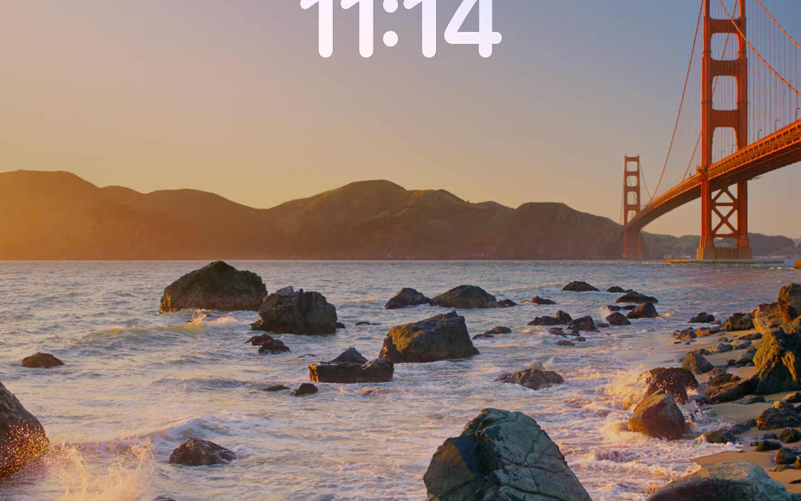
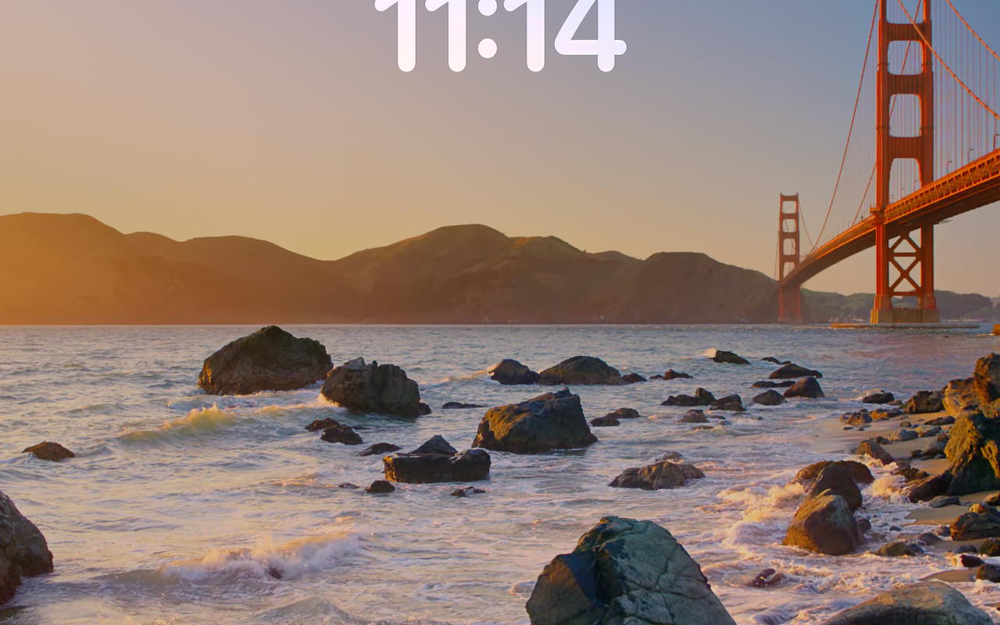
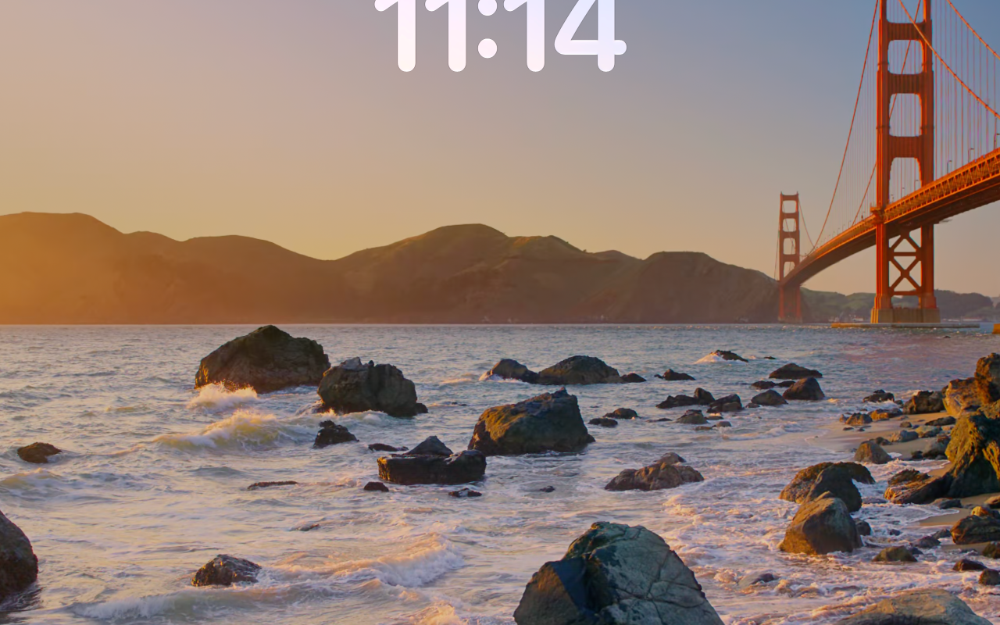

# Manual — Configuración

> Corresponde a la versión 1.0.0. Desde el menú lateral: **Configuración**.

Configuración administra el negocio: sus datos, los empleados y sus permisos, y las
opciones del sistema (ticket, impresora, exportaciones, atajos, copias de seguridad).
Tiene cinco tabs: **Negocio**, **Empleados**, **Permisos**, **Sistema** y **Acerca de**.

> Cada tab y cada sección se muestran **según los permisos del usuario**: un empleado
> sin permisos de configuración ve menos (o no ve) estas pantallas.

## Tab Negocio

Los datos que identifican al negocio (aparecen, por ejemplo, en los tickets):

1. Cargá **Nombre *** y **Giro *** (obligatorios) y, si querés, **Dirección**,
   **Teléfono**, **RFC** y **Correo**.
2. Tocá **Guardar**.

## Tab Empleados

Quienes pueden usar el sistema, cada uno con su alias, código y rol.

- **Nuevo**: cargá **Alias *** y **Código *** (lo que se teclea en el login),
  nombre completo, **rol** y **contraseña**, y guardá.
- El ícono de **llave** de cada fila abre los **permisos** de ese empleado.
- **Lápiz** para editar (al editar, la contraseña vacía no se cambia) y
  **papelera** para eliminar, con confirmación.

## Tab Permisos

**Permisos por rol**: qué puede ver y modificar cada rol. Marcá los permisos de cada
rol y tocá **Guardar**. Las demás pantallas (y las secciones de Sistema) se muestran
o esconden según estos permisos.

## Tab Sistema

Un listado de secciones; al tocar una, su formulario ocupa la pantalla y
**← Volver** regresa al listado.

### Configuración de Ticket

**Encabezado** y **pie** del ticket. Tocá **Guardar Ticket**.

### Configuración de Impresora

Para la impresora térmica ESC/POS:

1. Tocá **Detectar puertos** y elegí el **Puerto** detectado (o escribilo a mano).
2. Cargá **ID Dispositivo** y elegí el **Tamaño de Papel** (80 mm o 58 mm).
3. Marcá **Imprimir ticket al confirmar la venta** si querés que salga solo.
4. Tocá **Imprimir prueba** para comprobar la conexión y **Guardar Impresora**.

### Ruta de exportación de reportes

**Carpeta base** donde quedan los reportes exportados desde Reportes (vacío =
Documentos/MyLittlePOS/reportes). Con **Elegir carpeta…** se elige con el explorador,
y la opción de subcarpeta por período agrupa los archivos por rango de fechas.
Tocá **Guardar Ruta de Exportación**.

### Atajos de teclado

Teclas que disparan acciones del PV. Tocá **Cambiar** en una fila y apretá la tecla
nueva: acepta **F1–F12** o combinaciones con **Ctrl/Alt** (una tecla sola chocaría con
lo que se está tipeando). **Esc** queda libre para cancelar. Si la tecla ya está
usada por otra acción, se avisa.

### Eliminar datos del negocio (solo administradores)

Borra **todo**: productos, ventas, compras, empleados, permisos y el resto de la
información del negocio. Pide **confirmar la contraseña**; no se puede deshacer.

### Copia de seguridad (solo administradores)

Genera una **copia completa** de la base de datos en un archivo `.realm`.

1. Elegí la **Carpeta de destino** con **Elegir carpeta…** (vacío =
   Documentos/MyLittlePOS/backups).
2. Tocá **Crear copia de seguridad**.

> Para volver a una copia, el archivo `.realm` se reemplaza a mano con la aplicación
> cerrada; una copia no se "instala" desde la app.

## Tab Acerca de

La versión de MyLittlePOS y los componentes del sistema.

---

**Ver también**: [Manual de Productos](manual-productos.md) ·
[Manual de Reportes](manual-reportes.md) · [Manual de Caja](manual-caja.md)
