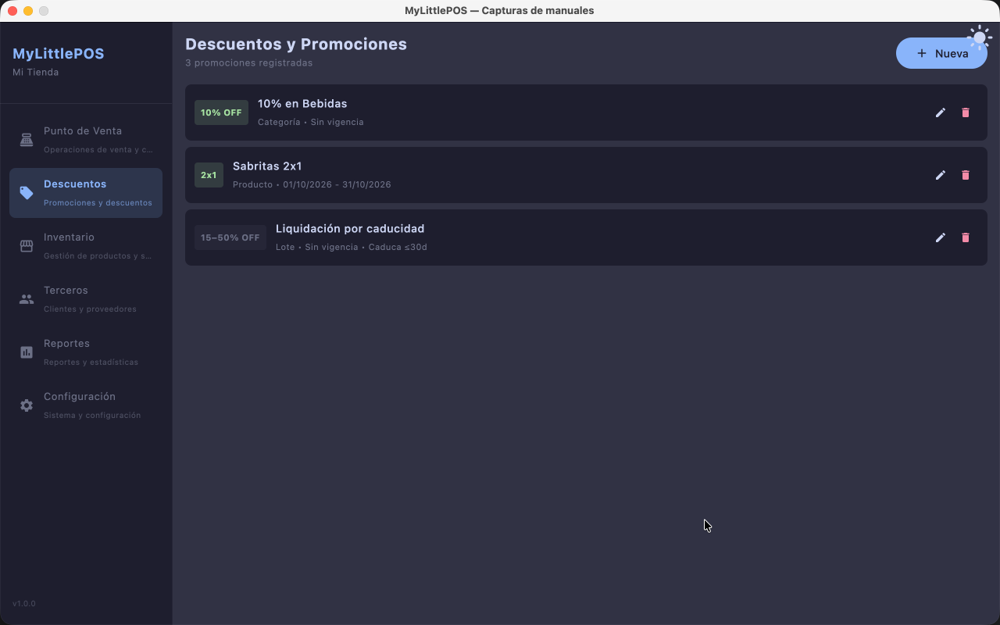
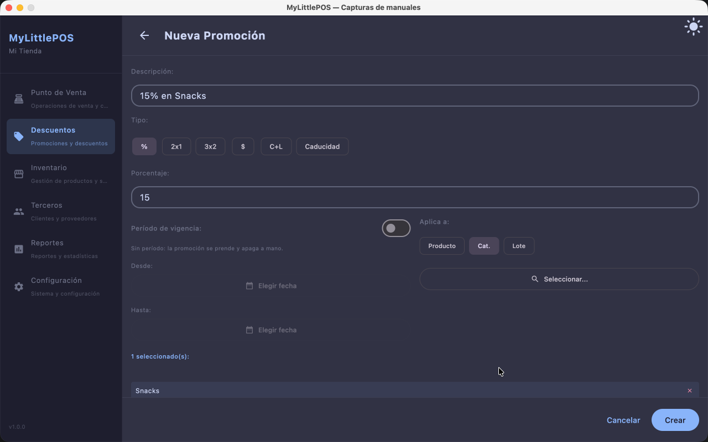
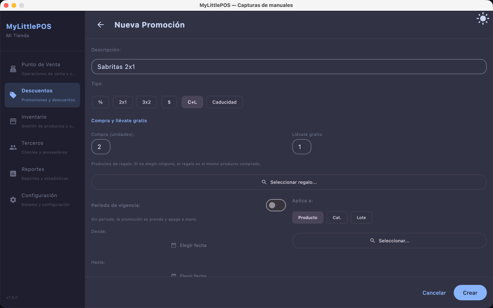
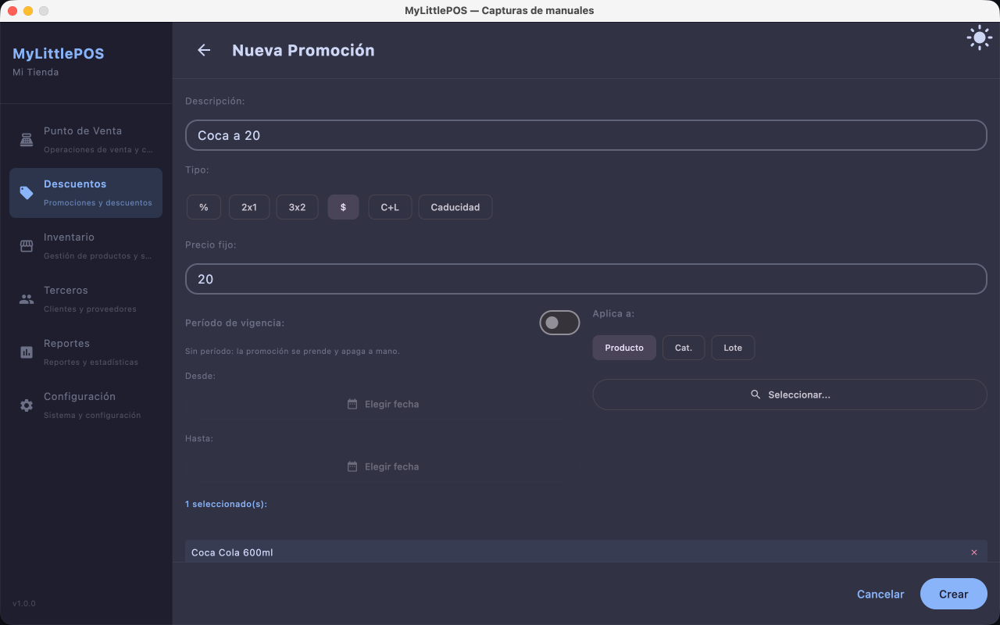
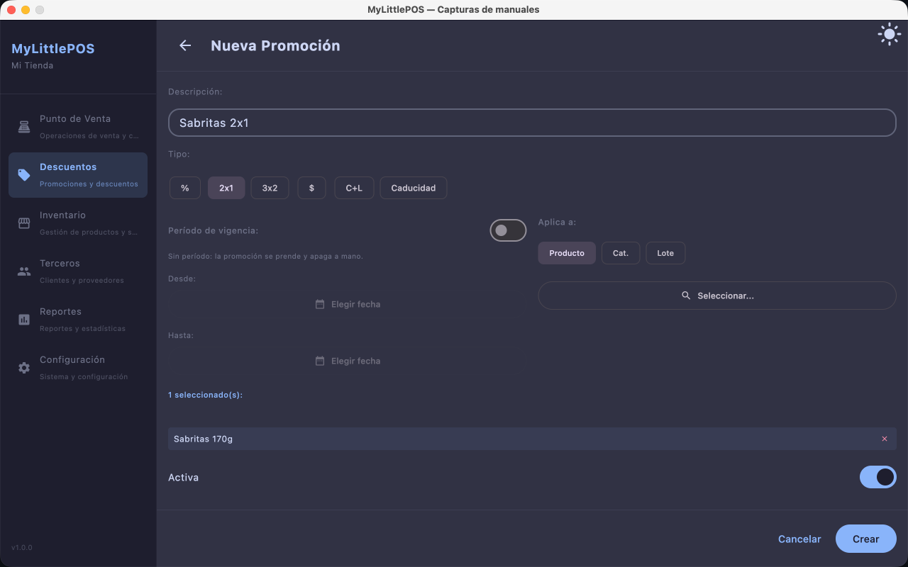
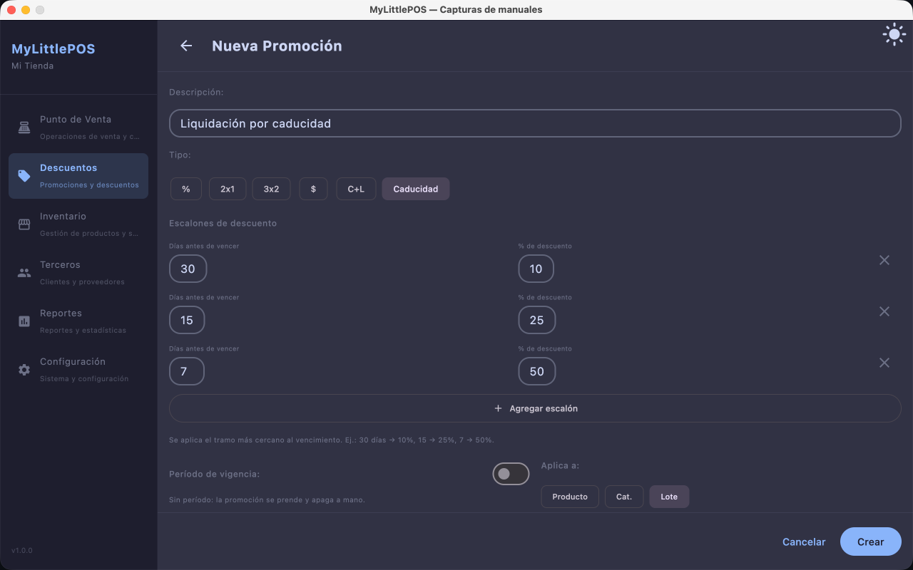
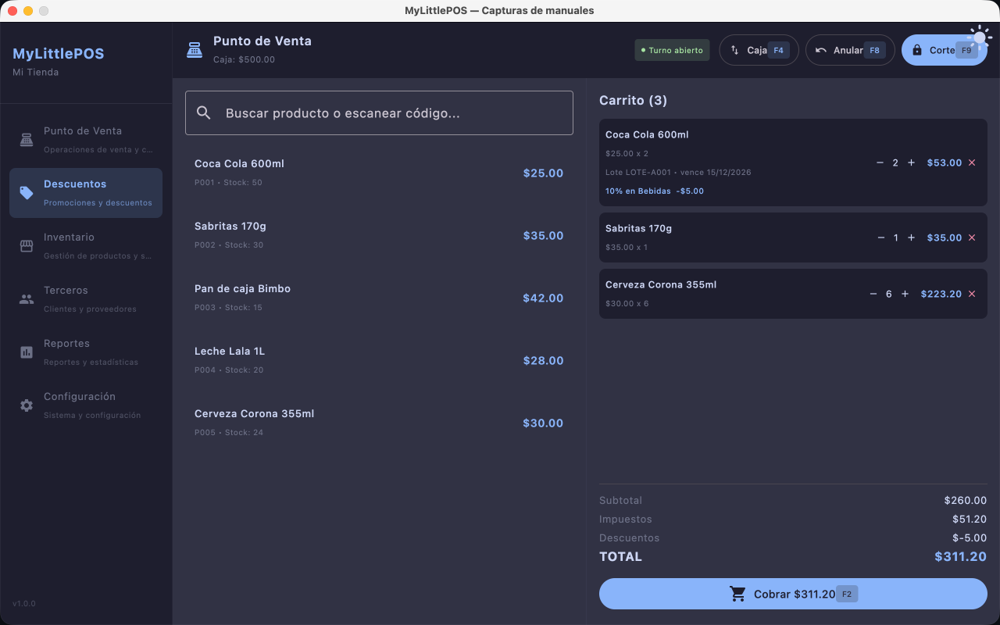

# Manual — Descuentos y Promociones

> Corresponde a la versión 1.0.0. Desde el menú lateral: **Descuentos**.

Las promociones aplican descuentos automáticamente en el Punto de Venta: se crean aquí
una vez y, mientras estén vigentes, el PV las aplica solo al cobrar.

## La lista

Cada promoción aparece como una tarjeta con su tipo y su estado:

- **% OFF** (descuento por porcentaje), **2x1**, **3x2**, **$… c/u** (precio fijo),
  **C+L** (compra y llévate) y **Caducidad** (descuento por vencimiento).
- **Aplica a**: producto, categoría o lote.
- **Vigencia**: el rango de fechas, o **Sin vigencia** si se prende y apaga a mano.
- El interruptor **Activa** prende o apaga la promoción al instante, incluso si está
  vigente.

## Crear una promoción

1. Ve a **Descuentos** y haz clic en **Nueva**.
2. Carga la **descripción** (el nombre que vas a reconocer en la lista).
3. Elige el **Tipo**:
   - **%**: descuento porcentual sobre el importe (carga el porcentaje).
   - **2x1** / **3x2**: llevas dos y pagas uno, o llevas tres y pagas dos.
   - **$**: **precio fijo** por unidad.
   - **C+L** (**compra y llévate**): compras N unidades y llevas M gratis. Por defecto
     el regalo es el mismo producto; con **Seleccionar regalo…** puedes elegir otros
     productos de regalo.
   - **Caducidad**: descuento progresivo según lo que falte para vencer (ver abajo).
4. Elige **Aplica a**: **Producto**, **Categoría** o **Lote**, y haz clic en **Seleccionar…**
   para marcar a qué se aplica.
5. **Período de vigencia** (opcional): marca el período y elige **Desde** y **Hasta**
   con el calendario. Sin período, la promoción se prende y apaga solo con el
   interruptor **Activa**.
6. Haz clic en **Crear**.

### Descuento por caducidad

El tipo **Caducidad** aplica un descuento mayor mientras más cerca esté el vencimiento.
Se configura con **escalones** de "días antes de vencer" + "% de descuento":

> Ej.: 30 días → 10%, 15 → 25%, 7 → 50%.

Se aplica siempre el **tramo más cercano al vencimiento**: si al producto le quedan
10 días, le corresponde el 25% (tramo de 15). Las unidades se toman del lote próximo
a vencer.

La cara del formulario cambia según el tipo elegido. Con **C+L** (compra y llévate)
aparecen los campos "Compra (unidades)" y "Llévate gratis" más el botón de regalo:

Con **$** (precio fijo) el formulario solo pide el precio por unidad al que se vende
el producto, sin porcentajes:

Con **2x1** (o **3x2**) no hay campo de importe: solo eliges el producto y la promoción
se aplica sola en el carrito al llevar las unidades mínimas:

Con **Caducidad** el formulario muestra el editor de escalones (días antes de vencer
→ % de descuento):

## En el Punto de Venta

Al abrir el PV se cargan las promociones vigentes. Mientras una promoción esté
**activa** (y en su período, si tiene), el descuento aparece **solo**, línea por
línea, en el carrito — no hay que tocar nada al cobrar.

---

**Ver también**: [Manual del Punto de Venta](manual-punto-de-venta.md) ·
[Manual de Caducidad y Lotes](manual-inventario.md) ·
[Manual de Caja](manual-caja.md)
