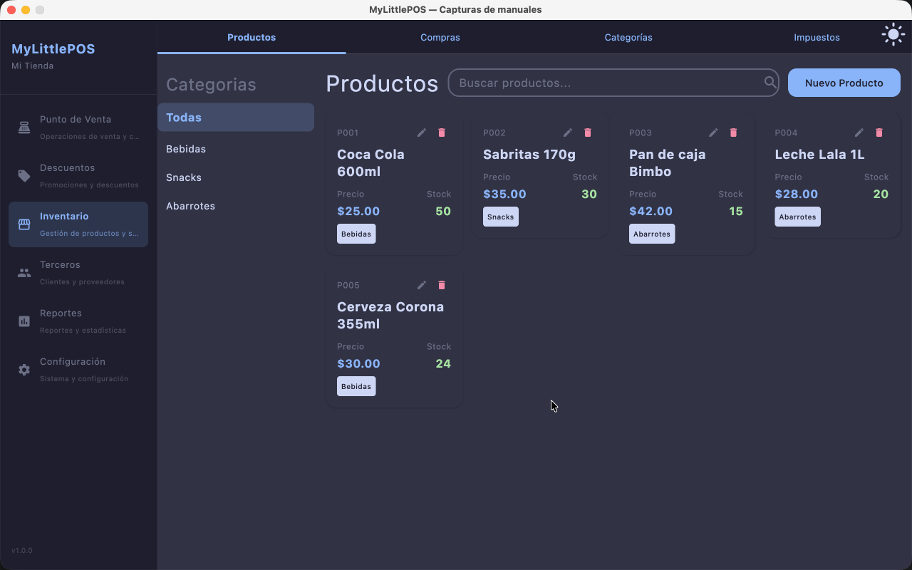
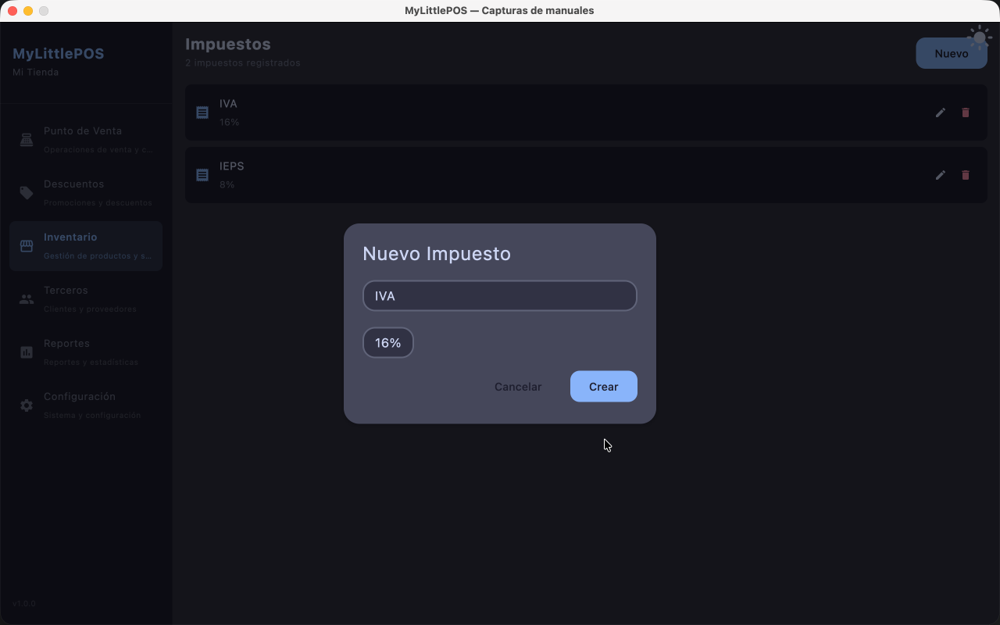

# Manual — Inventario

> Corresponde a la versión 1.0.0. Desde el menú lateral: **Inventario**.

La sección Inventario es el centro de gestión de mercadería. Tiene cuatro tabs:
**Productos**, **Compras**, **Categorías** e **Impuestos**.

---

## Tab Productos

El catálogo de artículos que se venden en el PV: alta, edición, precios, stock, lotes y
bajas. Se documenta por separado:

→ **[Manual de Productos](manual-productos.md)**

## Tab Compras

Registro de mercadería comprada a proveedores: la compra actualiza el stock y el costo de
los productos, y su pago puede registrarse como salida de caja del turno abierto.
*Manual de Compras: próximamente.*

## Tab Categorías

Alta, edición y baja de las categorías con las que se agrupan los productos.

→ **[Manual de Categorías](manual-categorias.md)**

## Tab Impuestos

Catálogo de tasas impositivas (IVA, IEPS, etc.) que se aplican a los productos.

### Crear una tasa

1. Andá a **Inventario → tab Impuestos**.
2. Tocá el botón de **nuevo impuesto**.
3. Cargá el **nombre** y la **tasa %** (solo números, obligatorios) y guardá.

### Aplicar una tasa a un producto

Las tasas se asignan **desde el formulario del producto**
(Inventario → Productos → producto → check **Impuestos**). También se puede crear una
tasa nueva desde ahí mismo, y queda aplicada automáticamente.

---

**Ver también**: [Manual de Productos](manual-productos.md) ·
[Manual de Categorías](manual-categorias.md) · [Manual del Punto de Venta](manual-punto-de-venta.md)
