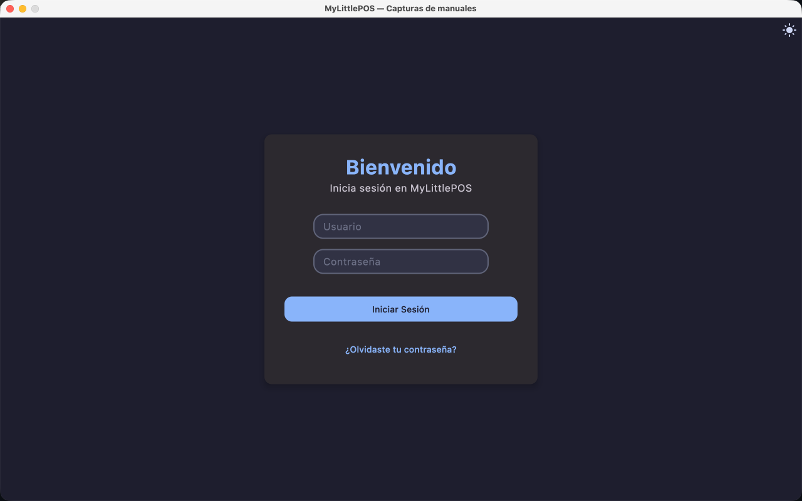
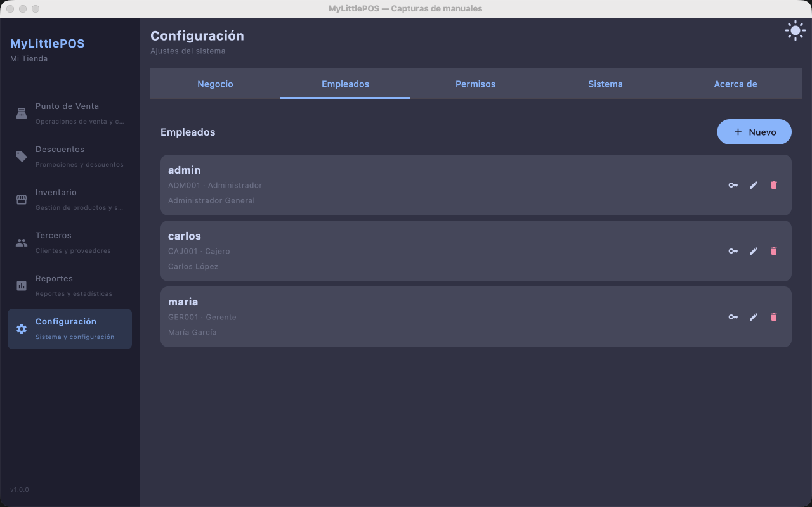

# Manual — Inicio de sesión

> Corresponde a la versión 1.0.0. MyLittlePOS pide iniciar sesión **cada vez que abres la
> aplicación**: la sesión no se guarda entre ejecuciones.

## Cuándo aparece

- **Instalación nueva**: el primer arranque abre el **asistente de configuración inicial**;
  al finalizarlo aparece esta pantalla (ver
  [Manual de configuración inicial](manual-configuracion-inicial.md)).
- **Ya configurada**: la aplicación abre directo en el inicio de sesión.

## Datos que ingresas

| Campo | Qué es |
|-------|--------|
| **Usuario** | el **alias** de tu cuenta, por ejemplo `admin`. |
| **Contraseña** | la contraseña de ese empleado. |

1. Escribe tu usuario y tu contraseña.
2. Haz clic en **Iniciar Sesión**.

> El **Código de Ingreso** (el PIN numérico del asistente) **no se usa para entrar**: es el
> identificador interno del empleado. Lo ves en **Configuración → Empleados**, al lado del rol.

## Si no entra

Si el usuario o la contraseña no coinciden, abajo aparece el aviso **Credenciales inválidas**
con el botón **OK** (también se cierra solo a los pocos segundos). No se abre nada: corrige
los datos e inténtalo de nuevo.

> Un empleado al que **no** se le guardó contraseña no puede entrar nunca: el sistema no
> acepta cualquier cosa en su lugar.

## Restablecer una contraseña

No hay recuperación automática desde esta pantalla. Un **administrador** la repone desde
**Configuración → Empleados**:

1. Haz clic en el **lápiz** de la fila del empleado.
2. Deja **Contraseña** y **Confirmar contraseña** con la nueva clave (al editar, dejarlas
   vacías significa *no cambiarla*).
3. Haz clic en **Guardar**.

## Qué ves al entrar

El menú lateral con las secciones que tus **permisos** habilitan: **Punto de Venta**,
**Descuentos**, **Inventario**, **Terceros**, **Reportes** y **Configuración**. Un empleado
con permisos acotados ve menos secciones. Quién define qué ve cada rol es el administrador,
en **Configuración → Permisos** (ver [Manual de Configuración](manual-configuracion.md)).

## Cerrar la sesión

1. Ve al **Punto de Venta** y haz clic en **Corte** (ver [Manual de Caja](manual-caja.md)).
2. Al pie del informe, haz clic en **Cerrar sesión**.

La aplicación vuelve a esta pantalla y deja de mostrar el turno y el carrito. **Cerrar sesión
no cierra el turno**: si lo dejaste abierto, al volver a entrar sigue abierto.

> También se cierra la sesión al hacer un **Eliminar datos del negocio**
> (Configuración → Sistema).

---

**Ver también**: [Manual de configuración inicial](manual-configuracion-inicial.md) ·
[Manual de Configuración](manual-configuracion.md) · [Manual del Punto de Venta](manual-punto-de-venta.md)
