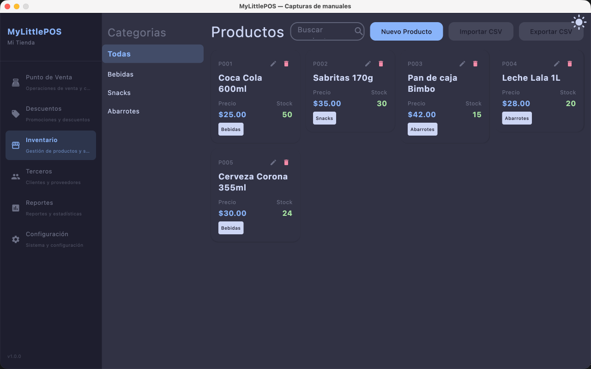
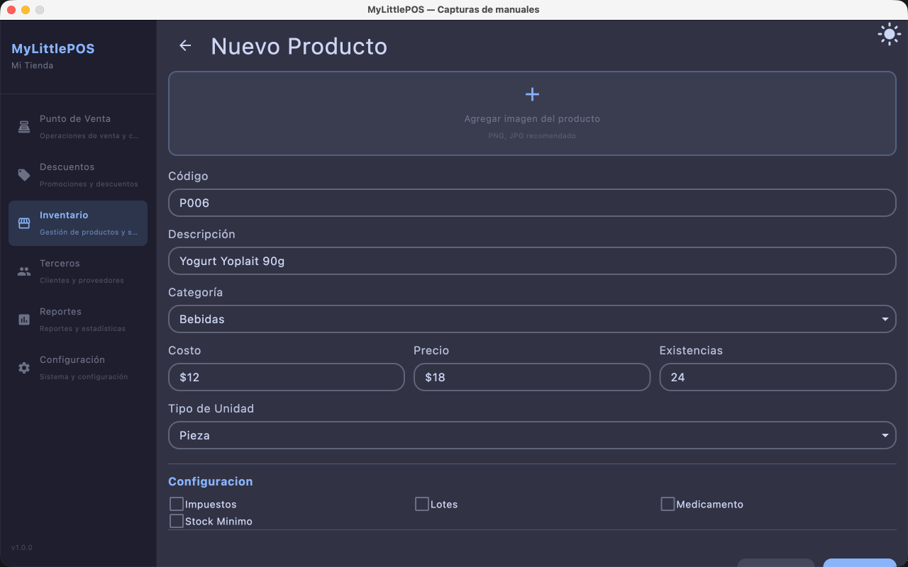
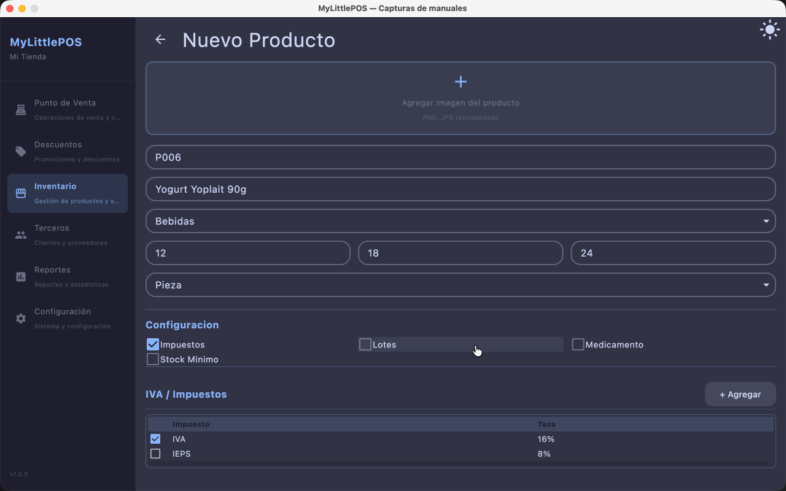

# Manual — Productos

> Corresponde a la versión 1.1.0. Desde el menú lateral: **Inventario → tab Productos**.

El catálogo de productos es la base de todo el sistema: lo que está aquí se puede vender
en el Punto de Venta.

---

## 1. Ver el catálogo

La tab **Productos** muestra los productos en **tarjetas** (código, descripción, precio,
stock y categoría). Cada tarjeta tiene dos iconos: **editar** ✏️ y **eliminar** 🗑.

Para encontrarlos:

- **Búsqueda** (arriba): escribe parte del código o de la descripción para filtrar.
- **Filtro por categoría** (izquierda): el panel **Categorías**, que empieza en **"Todas"**.

## 2. Crear un producto

Haz clic en **Nuevo Producto** (arriba a la derecha) y completa el formulario:

### Campos básicos

| Campo | Regla |
|-------|-------|
| **Código** | Obligatorio. Es el que lee el escáner de código de barras. |
| **Descripción** | Obligatoria. Nombre del producto tal como se muestra y se imprime. |
| **Costo** | Lo que te cuesta al comprar: números con decimales; se muestra con `$` y separador de miles (ej.: `$1,250.50`). |
| **Precio** | Precio de venta: números con decimales, con el mismo formato `$`. |
| **Existencias** | Stock actual (solo números). |
| **Tipo de unidad** | Pieza, kilo, etc. Por defecto: Pieza. |
| **Sub-unidad** | Segunda unidad (ej.: caja de 10). Al cambiar el tipo de unidad, la sub-unidad se limpia porque la anterior ya no aplica. |
| **Categoría** | Se elige del catálogo de categorías. |
| **Imagen** | Selecciona una foto del producto o quita la que tenga. |
| **Stock mínimo** | Piso de alerta de reposición. El campo aparece al marcar la casilla **Stock mínimo** (ver abajo). |

### Secciones opcionales (casillas)

En la parte de abajo del formulario, la sección **Configuración** tiene cuatro casillas
que habilitan secciones adicionales:

- **Impuestos**: marca las tasas del catálogo (IVA, IEPS, etc.) que aplican al producto.
  Desde ahí mismo también puedes **crear una tasa nueva** (nombre + %) y queda aplicada al
  producto automáticamente.
- **Lotes**: para productos con control de vencimiento. Cada lote tiene **número de
  lote**, **fecha de vencimiento** y **existencias** que entran a ese lote.
  - El **día es opcional**: si dejas el día vacío, el sistema toma el **último día del
    mes** (ej.: "vence 03/2026" queda como válido hasta el 31 de marzo de 2026). Esa
    convención se muestra en el propio formulario.
  - Con lotes, en el PV al agregar el producto te pide elegir de qué lote sale.
- **Medicamento**: habilita los **compuestos activos** del producto (nombre, cantidad y
  unidad, ej.: 500 mg).
- **Stock mínimo**: habilita el campo de **Stock mínimo** (piso de alerta de reposición).

Haz clic en **Guardar**: el producto se guarda y aparece un aviso de éxito **sin cerrar el
formulario**. Al **crear**, los campos se limpian para cargar el siguiente; al **editar**,
los datos siguen en pantalla por si quieres seguir ajustándolos.

## 3. Editar un producto

Haz clic en el icono de **editar** ✏️ de la tarjeta: se abre el formulario con los datos
cargados. Ajusta lo que haga falta y guarda.

> **Historial de precios**: cada vez que cambia el costo o el precio, el sistema registra
> el valor nuevo con la fecha. Así se puede responder "por qué este producto cuesta lo que
> cuesta". Las compras que finalizan también actualizan el costo y quedan marcadas con su
> origen.

## 4. Dar de baja un producto

Haz clic en el icono de **eliminar** 🗑 de la tarjeta y confirma en el diálogo. Es una
**baja lógica**:

- el producto **sale del catálogo**: ya no aparece en la lista ni se puede vender en el PV;
- **conserva todo**: historial de precios, movimientos y existencias siguen contando en el
  sistema (una compra o devolución posterior no lo "revive" por accidente).

Si necesitas volver a venderlo más adelante, se crea de nuevo con el mismo código.

## 5. Importar y exportar CSV

Arriba del catálogo, junto a **Nuevo Producto**, están los botones **Importar CSV** y
**Exportar CSV**. **Importar** requiere permiso de creación de productos; **Exportar**
está siempre disponible.

### Importar CSV

1. Haz clic en **Importar CSV**: se abre **Importar productos (CSV)**.
2. **Descargar plantilla** genera un archivo con la estructura y ejemplos (columnas:
   `codigo`, `descripcion`, `categoria` (ruta `Cat1-Cat2`), `costo`, `precio`,
   `existencias`, `stockMinimo`, `tipoUnidad`, `esMedicamento`, `compuestos`,
   `impuestos`).
3. **Seleccionar archivo** elige tu planilla. El resultado se informa **fila por fila**:
   cuántos productos se importaron y qué filas se ignoraron, con su motivo (los códigos
   que ya existen en el catálogo **no se importan**: aparecen como "Código duplicado, no
   importado").
4. Si un impuesto viene **sin porcentaje**, el diálogo lo pide y se aplica con
   **Aplicar tasas**.

Las categorías de la columna `categoria` se crean solas si no existen y el producto queda
en el último nivel de la ruta (`A-B-C`).

### Exportar CSV

Haz clic en **Exportar CSV**: el explorador pide dónde guardar (nombre sugerido
`productos.csv`) y el archivo sale **en el mismo formato de la plantilla**, con todo el
catálogo. Sirve para respaldar o para editar en una planilla y volver a importar.

## 6. Errores comunes

| Aviso | Causa |
|-------|-------|
| Código / descripción marcados en rojo | Faltan los dos campos obligatorios. |
| "Producto sin stock" en el PV | Las existencias llegaron a 0. Carga stock o registra la compra que lo repone. |
| El producto no aparece en el PV | Puede estar dado de baja o el filtro de categoría lo está ocultando. |

---

**Ver también**: [Manual de Categorías](manual-categorias.md) ·
[Manual de Inventario](manual-inventario.md) · [Manual del Punto de Venta](manual-punto-de-venta.md)
