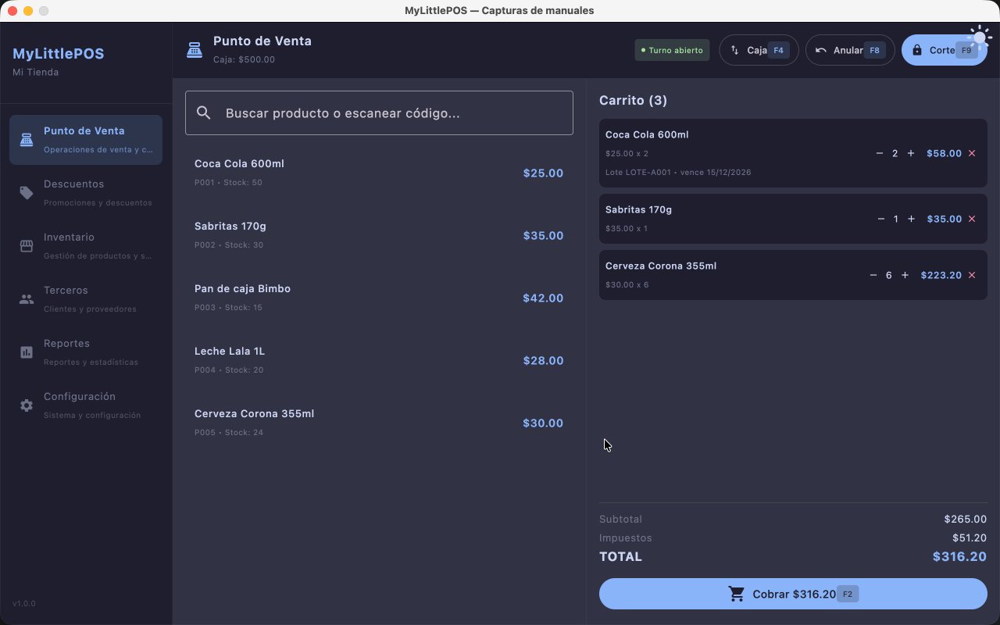
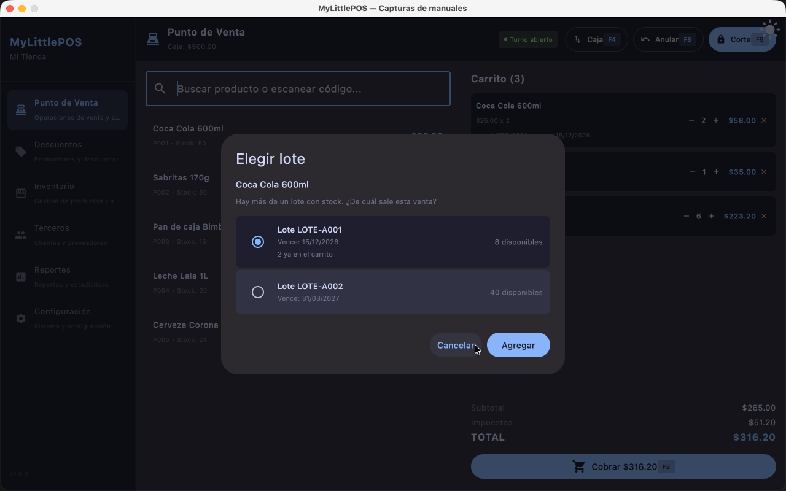
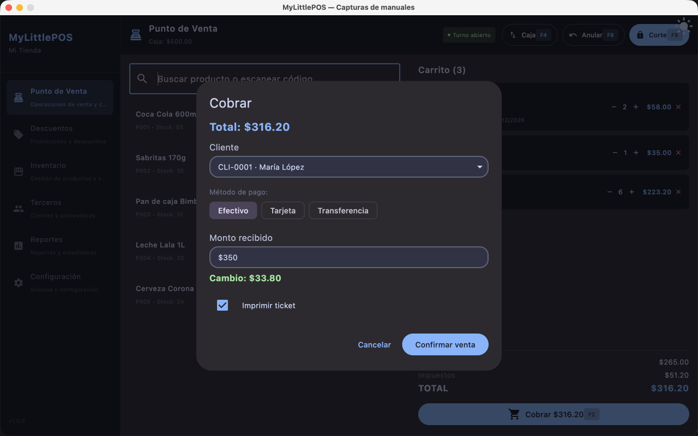
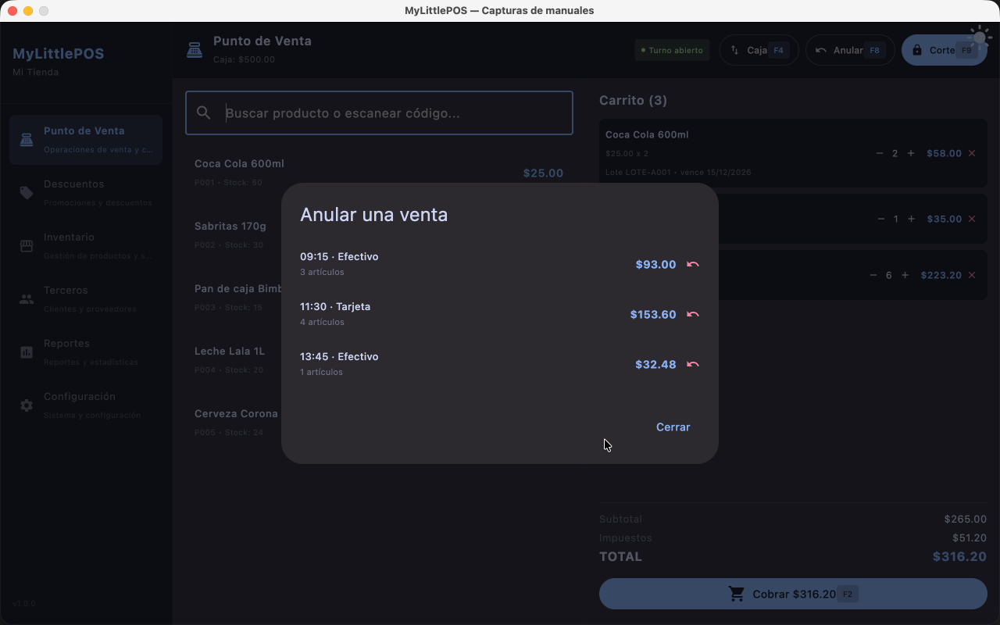

# Manual — Punto de Venta

> Corresponde a la versión 1.1.0. Desde el menú lateral, la sección **Punto de Venta**.

El Punto de Venta (PV) es donde se hacen las ventas del día: se abren turnos, se agregan
productos al carrito, se cobra y se cierra la caja.

---

## 1. Abrir el turno

Al entrar al Punto de Venta, si no hay un turno abierto aparece la pantalla de apertura:

1. Carga el **Saldo inicial**: el dinero con el que arranca el cajón (cambio del día).
2. Haz clic en **Abrir turno**.

Todo lo que se venda o se mueva de caja durante el día queda ligado a ese turno.

## 2. La pantalla de venta

Con el turno abierto, la pantalla tiene tres zonas:

- **Barra superior (header)**: muestra el turno actual y los botones de acción
  (**Anular**, **Caja** para los movimientos de caja y **Corte**).
- **Búsqueda de productos** (izquierda): un campo donde escribes o escaneas, y la lista de
  productos que coincide.
- **Carrito** (derecha): los productos de la venta en curso, con subtotal, impuestos,
  descuentos y total.

## 3. Agregar productos al carrito

Hay dos formas:

- **Búsqueda mientras escribes**: escribe parte del código o de la descripción; la lista se
  filtra mientras escribes. Haz clic en el producto para agregarlo.
- **Escáner de código de barras**: escanea el código. El producto entra **directo al
  carrito** sin tocar el mouse. Después de cada escaneo el cursor vuelve al campo de
  búsqueda automáticamente.

Si el producto se maneja por **lotes**, al agregarlo se abre un diálogo para elegir de qué
lote sale la mercadería.

El carrito **no vende más de lo que hay en stock**: si el producto no tiene existencias
avisa "Producto sin stock", y el `+` de una línea no pasa del stock disponible.

## 4. El carrito

- **`+` / `−`**: cambian la cantidad de la línea. Bajar la cantidad a 0 saca la línea.
- **`×`**: elimina la línea del carrito.
- Las **promociones vigentes** se aplican solas a cada línea; lo que descuentan se ve en la
  fila **Descuentos** de los totales.
- Los totales muestran **Subtotal**, **Impuestos**, **Descuentos** (cuando hay algún
  descuento) y **Total**.

## 5. Cobrar

Haz clic en **Cobrar** (o la tecla F2) y se abre el diálogo de cobro:

1. **Cliente**: por defecto viene "Mostrador no registrado". Si el cliente está registrado
   en **Terceros → Clientes**, elígelo del desplegable para que quede en la venta y en el
   ticket.
2. **Método de pago**: efectivo, tarjeta o transferencia.
3. Si elegiste **efectivo**, carga el **Monto recibido**: el cambio se calcula solo y se
   muestra en pantalla. El monto tiene que alcanzar el total; si no, el diálogo marca el
   campo con el error.
4. Revisa el check **Imprimir ticket**: viene marcado o desmarcado según el valor
   predeterminado de [Configuración → Impresora](manual-configuracion.md) y decide, **venta
   por venta**, si quieres el ticket.
5. Haz clic en **Confirmar venta**.

La venta queda registrada, el carrito se vacía y queda listo para el siguiente cliente.

### El ticket

Con el check **Imprimir ticket** marcado en el cobro (viene marcado cuando está activado
**"Imprimir ticket por defecto al confirmar la venta"** en
**Configuración → Sistema → Impresora**), al confirmar la venta se imprime el ticket con el
encabezado y el pie configurados, el número del ticket, los artículos, los totales y el
método de pago. Si el cliente no es mostrador, también imprime su nombre.

Si la impresora falla, **la venta ya quedó registrada**: aparece un aviso indicando que no
se pudo imprimir, pero no se pierde nada. Revisa la conexión de la impresora en
Configuración.

## 6. Movimiento de caja (F4)

Durante el turno pueden entrar o salir billetes del cajón que no son ventas (giros,
retiros, depósitos). Para registrarlos:

1. Haz clic en el botón **Caja** de la barra superior (movimiento de caja) o aprieta **F4**.
2. Elige si es **entrada** o **salida**.
3. Carga el **monto** y un **motivo** (obligatorio, máximo 60 caracteres).
4. **Registrar**.

Los movimientos quedan en el resumen del corte.

## 7. Anular una venta (F8)

Si una venta se hizo mal, se puede anular **mientras el turno siga abierto**:

1. Haz clic en el botón **Anular** de la barra superior (o **F8**). Requiere permiso de
   anulación.
2. Se listan las ventas del turno que todavía se pueden anular.
3. Elige la venta y confirma.

La venta anulada **no suma en los totales ni en el efectivo esperado del corte, ni en los
totales de los reportes de ventas**; el corte y los reportes la muestran **aparte** (cantidad
y total anulado) como testigo de lo que se anuló.

## 8. Cerrar el turno: el corte de caja

Cuando terminas el día (o el turno):

1. Haz clic en el botón **Corte** de la barra superior (corte de caja, o **F9**) y confirma.
2. Se muestra el resumen del turno:
   - total de ventas, cantidad de ventas y de artículos;
   - ventas en **efectivo**, **tarjeta** y **transferencia** por separado;
   - **Ventas anuladas** y **Total anulado** (solo si hubo anuladas: no suman en ningún
     total, quedan como testigo de la merma);
   - **entradas** y **salidas** de caja (los movimientos registrados);
   - el detalle de los movimientos y de los artículos vendidos;
   - el **Efectivo que debería haber**: lo que debería haber en el cajón
     (saldo inicial + ventas en efectivo + entradas − salidas).
3. Al salir del resumen puedes:
   - **Imprimir** el resumen (mismo contenido que se ve en pantalla), o
   - **Iniciar nuevo turno** (sigue la atención), o
   - **Cerrar sesión** y volver al login.

Cuenta el efectivo del cajón y compáralo con el efectivo esperado: cualquier diferencia se
ve ahí mismo.

## 9. Atajos de teclado

| Tecla | Acción |
|-------|--------|
| **F2** | Cobrar |
| **F3** | Selecciona el campo de búsqueda |
| **F4** | Movimiento de caja |
| **F8** | Devolución / anulación de venta |
| **F9** | Corte de caja |

---

**Ver también**: [Manual de Productos](manual-productos.md) ·
[Manual de Categorías](manual-categorias.md) · [Manual de Inventario](manual-inventario.md)
