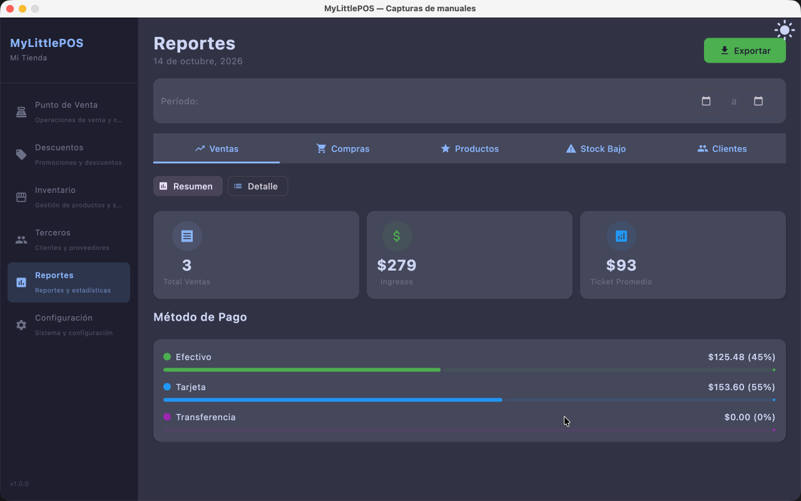
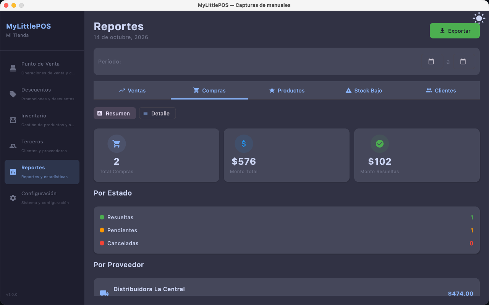
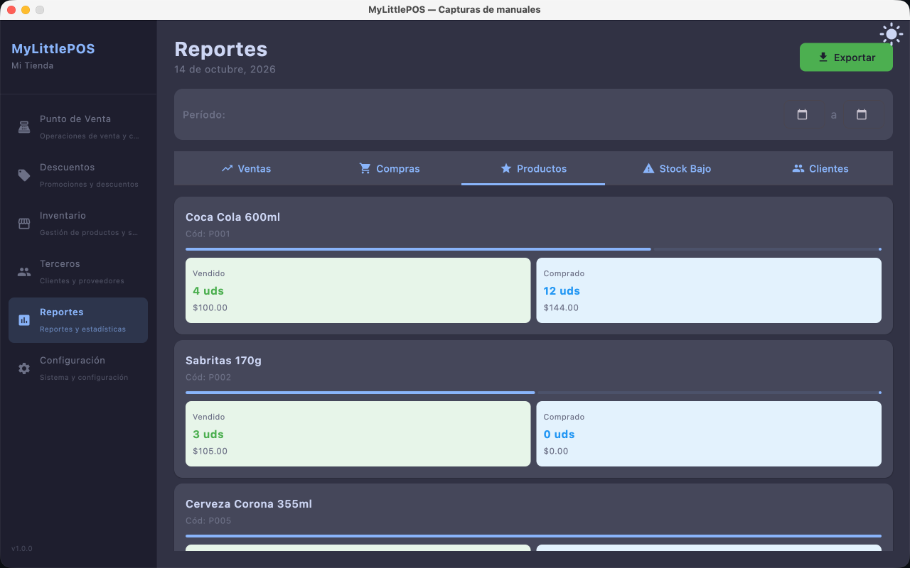
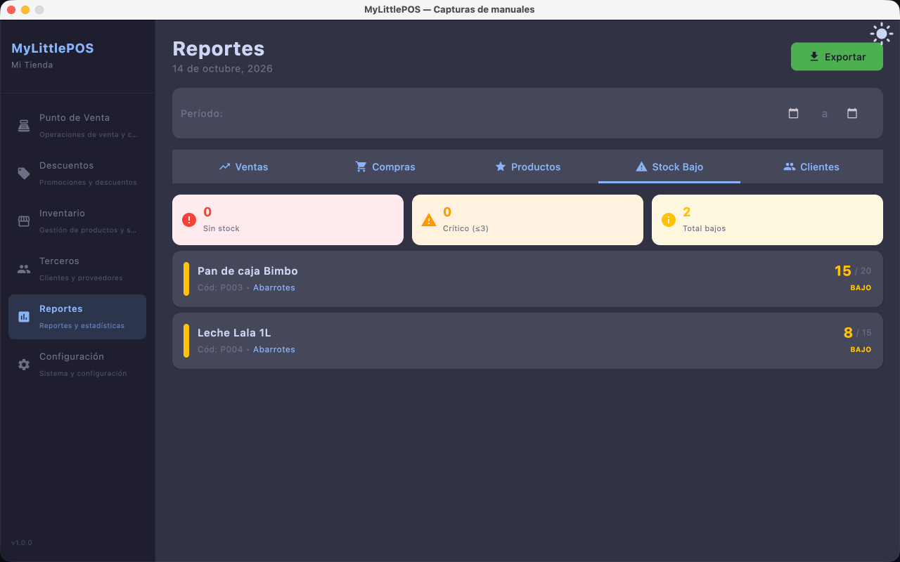
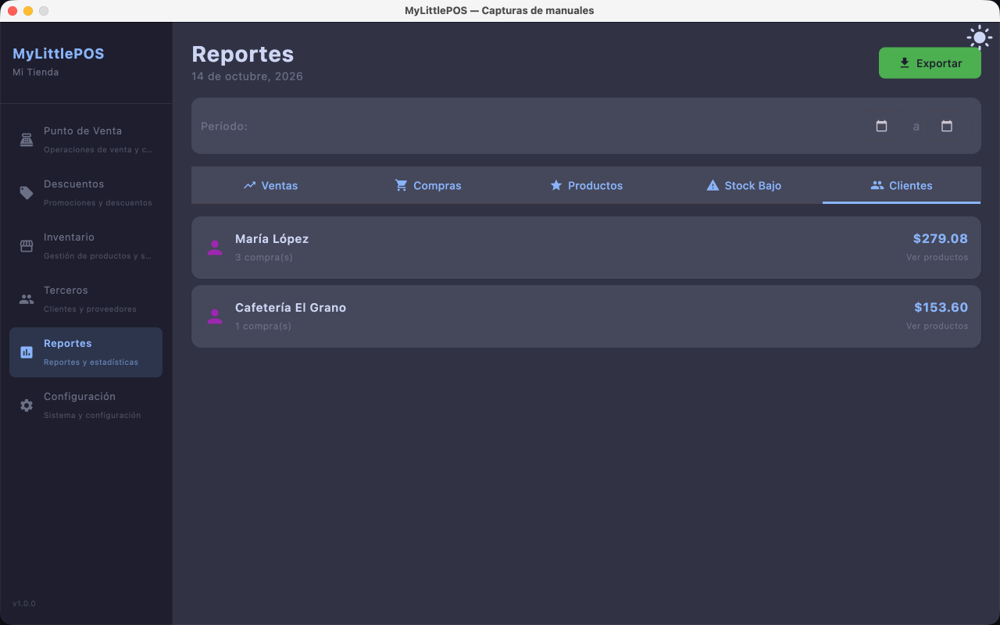

# Manual — Reportes

> Corresponde a la versión 1.0.0. Desde el menú lateral: **Reportes**.

Los reportes muestran qué pasó con el negocio en un período: ventas, compras,
movimiento de productos, stock bajo y clientes.

## Período y pestañas

1. Elige el rango de fechas en **Período:** (desde / hasta).
2. Elige el reporte entre las pestañas:
   - **Ventas** · **Compras** · **Productos** · **Stock Bajo** · **Clientes**.
3. Cada reporte tiene dos vistas, con el conmutador **Resumen** / **Detalle**:
   los KPI y agregados, o el listado fila por fila.

### Ventas (Resumen)

- KPIs: **Total Ventas**, **Ingresos**, **Ticket Promedio**.
- **Método de pago**: efectivo, tarjeta y transferencia con su porcentaje.
- **Observaciones**: ventas canceladas y devueltas.

### Ventas (Detalle)

Una fila por venta: fecha, método, cantidad de artículos y total. Toca
**Ver productos** para ver el desglose de esa venta (cantidades, precios y descuentos).

### Compras

- Resumen: total de compras, monto total, monto resueltas, compras **por estado**
  (resueltas, pendientes, canceladas) y **por proveedor**.
- Detalle: una fila por compra con fecha, proveedor y folio. **Ver detalle** abre las
  líneas de la compra.

### Productos

Movimiento de cada producto en el período: **Vendido** (unidades e importe) y
**Comprado** (unidades y costo), por producto.

### Stock Bajo

Aviso de reposición: cuenta de productos **sin stock**, **críticos** (existencias ≤ 5)
y **total bajos**, con el detalle de cada uno (existencias / stock mínimo) y su
categoría. Si todo está en orden se muestra **Stock suficiente**.

### Clientes

Quiénes compraron en el período: compras y monto por cliente. **Ver productos** abre
qué compró cada uno.

## Exportar

1. Toca **Exportar** (arriba a la derecha).
2. Elige el formato:
   - **CSV (Excel)**: archivo de texto separado por comas.
   - **PDF (Impresión)**: documento listo para imprimir.
3. Aparece **✅ Exportado exitosamente** con la carpeta donde se guardó el archivo.

> El rango de fechas es el mismo que el del reporte que estás mirando.

---

**Ver también**: [Manual de Ventas (PV)](manual-punto-de-venta.md) ·
[Manual de Compras](manual-compras.md) · [Manual de Productos](manual-productos.md) ·
[Manual de Clientes y Proveedores](manual-clientes-proveedores.md)
